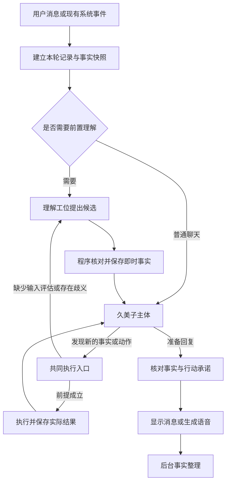

# 听懂意图、核实行动、持续记住：审视与补强方案

## 2026-11-02 已批准实施：完整分工与记忆维护

状态：本地架构实现与联合验证完成；真实服务商与设备验收待续。完成范围以本节和[当前状态](../worklog/CURRENT.md)为准；后文历史设计与R01–R11记录不代表新增待办。

#### 实施记录（2026-11-02）

- 所有工位共用实际请求计数、前后台槽、取消、期限及配置版本保护；天气/假日等前置请求与聊天共用根身份。高级设置允许独立服务商和模型，保存不联网。模型输入记录来源身份/版本，工具ID、多模态和历史协议保持结构，不保存完整提示与密钥。未调用真实付费API。
- schema13六表、executionState v3、旧v1/v2兼容及清理规则合并已接入；正文、记忆资产版本和执行状态用同一数据库读快照构造备份。恢复不会重置本小时请求计数或丢失本机媒体清理义务。服务密钥不随便携备份导出，换机器需重新提供凭据；跨IndexedDB与原生SQLite仍用屏障和恢复日志，不宣称全局事务。
- 摘要、日记、地点解析和执行归档进入统一持久队列。生成检查点、正式保存、索引写入和可检索分别处理；索引失败不重新生成，RAG关闭仍保存正文，开启后只补有效来源。
- 状态候选经程序授权/来源/版本核验后与回执同事务提交；心理效果与首回复、日记正文与获准反思保留原子性。日记叙事不产生外部事实，重写、索引与历史补齐不重复结算。取消阻止未提交结果，不倒退已读事实或已执行行动。
- 普通删除只改变本侧视图；修改历史原文导向“记忆维护”，清除错误来源后可重新告知正确事实。预览分别列确定关联、仅同输入的疑似材料、无来源私人派生、未引用图片与语音；疑似材料与未知媒体需独立确认，不能把同上下文关系当作确定污染或自动删除无关原始消息。
- 维护屏障覆盖旧窗口、旧模型回包、索引、导出与自动备份。失败保持未完成并重启续作；被清原文、派生记录、任务检查点、原生历史/索引、执行压缩档与受控备份按范围处理，只保留无正文防重标记。已发生行动与历史心理不做机械逆算。
- 语音写入/导入图片先登记来源；语音租约跨窗口保护写入到落盘，崩溃后可清理无引用文件。恢复重映射媒体和登记身份，保护旧文件及本机在途义务。旧私有目录中的孤立媒体可明确预览确认；仍被保留记录引用的共享媒体保留并展示。无引用图片/语音可能含未发送草稿，未获独立确认不清理。旧备份导入也要求确认排除无法追溯的无引用媒体。
- 本地联合记录：73份行为脚本、11份隔离Electron专项通过；覆盖双窗口/schema12→13、100/1000轮合成来源/任务、201001条执行记录、失败接续、真实生产RAG IPC+SQLite/HNSW两次启动、受控临时文件精确清理。原生媒体与通知的部分调用仍为替身，Windows链接拒绝用lstat替身验证。TypeScript、版本一致性及最终生产构建通过；生产UI完成工位配置→聊天→视图删除→预览确认→重载→旧备份导入，另验证中断保护页。86个本地文档链接/锚点及差异空白检查通过。真实模型质量及设备验收另列。
- 实际应用模型替身复验了“提醒已保存、回复故障、界面重发后只保留一个提醒”，外网阻断，不使用真实聊天。40条供应商用例仍未付费运行；Android按用户决定延期，Windows系统通知、休眠、旧2.x覆盖0.0.0未验收。
- 工程限制：单作业持久内容约1.9M字符、单条执行备份2Mi字符、分片总量512Mi字符；记忆资产来源最多10000条且有限制长度。超过边界会拒绝并保留原始数据，累计来源需后续分片。构建已有循环分包/包体积提示，不宣称无限容量、完全无风险或已实现常驻生活。

最终证据保存在本地`artifacts/verification/architecture-20261101/`，不加入Git。版本和应用身份未改变，本轮未提交、推送、发行或部署。

### 产品契约

一个对外久美子；主体、理解、核验、记忆、日记、历史查询、视觉与翻译仅分职责。内部模型只提候选，程序核对权限、来源和实际回执后提交。用户位置只来自聊天主动告知；未读收件不提前赋予知识。普通闲聊不固定加理解/核验请求。

配置分ConnectionProfile与RoleBinding，默认继承现有主/后台/视觉/翻译；高级设置可独立服务商和模型。密钥继续用系统保护引用，改端点不得复用旧秘密；ping只证明连通，不代表工具或任务质量。保存配置不联网，主动测试才发请求。

普通“从我的聊天中删除”只写messageViews，保留权威收件与角色记忆，不复用影响模型上下文的isHidden；撤回依据持久接收/阅读状态。用户通过单独记忆维护界面修正/清理时，必须清除当前应用目标原文及关联副本，不保留仅本人可见的隐藏原文。维护先预览与确认；不通过聊天标签授予破坏性维护权限。

### 统一调用与后台

TaskRequest含职责/操作、回合或作业身份、来源、输入、工具名单、取消、deadline；ResolvedBinding固定服务、模型、凭据和配置版本；TaskResult保留工具协议及供应商实际usage；RequestAttempt仅记录最少元数据，不记录提示/密钥。所有真实发送统一预留，主/后台跨窗口各1槽，前台活动时不启动新后台联网请求。

前台最多8次实际模型请求/180秒；工具4轮/12次/90秒且受整轮限制；网络最多自动重试1次、格式修复1次，共用预算。关闭SDK隐藏重试（Gemini attempts=1）。不自动换模型/服务，保留同服务备用密钥受控切换；取消历史查询偷偷降级。未知usage标未知，不声称金额硬上限。受影响配置变更令旧回包失效，保留已提交行动。

后台统一summary.generate/index、diary.generate/validation/reflection/index、location.resolve、execution.archive；提醒、通知撤销、自动备份仍保留专用流程。任务固定输入/版本、epoch/memoryGeneration、checkpoint、租约令牌与结果。请求在事务外，最终事务重核。租约120秒/每20秒续租、单次执行180秒；类型公平轮转，最多8次失败/中断；暂停/额度等待不计失败。后台20次远程请求/小时，含重试、云嵌入、地点解析，本地任务不占。新增暂停后台联网整理状态。关应用停止执行，重开续作，不冒充常驻主体。

摘要生成后先保存结果再索引；稳定段ID/版本/chunk序号防重复，索引失败不重生成、不重复推进游标。RAG关闭时正文仍保存，索引deferred，重新开启按有效来源补作。原生数据库写入与检索可用分别核验，跨库不宣称全局原子。

### 统一状态与日记

StateCandidate包含稳定事件/效果ID、触发类别（程序指定）、来源版本、目标版本、载荷和审核版本；同ID不同载荷拒绝，状态与回执同事务。心情/好感/block为同一审核原子组，首可见回复/psyche保留同事务，锚点按精确ID（旧协议仅唯一完全匹配）。时间漂移保留游标；block状态与平台调度分开、持久outbox补偿。保留现有评分和衰减。

主观反应不要求用户命令；外部事实/提醒需证据与授权。日记反思只引用已存有效经历；外部事实、模拟事件、推测和叙事不混用。失败核验存草稿，不进入正式索引/状态。日记正文、批准反思、片段结算、索引义务同事务；首次结算一次，重写/补齐/索引重试不再加心理值；旧日记不追溯执行。来源采用每次更新不可复用revision，固定输入快照在同一读事务获得，提交比较全部实际输入，不能只核验模型选择的引文。

### 来源与记忆维护

EvidenceRef与memoryDependencies区分明确引用、派生合并、判断依据、仅同上下文四类；新索引保存多来源，canonicalKey只是语义去重键。修复桌面按消息ID删除向量实际全删的接口差异，合并记忆按来源重建。

维护流程：预览→持久journal与代次/跨窗跨进程屏障→清除修正→重建→逐存储验证→完成。范围含消息原文与引用、失败/待发结果、摘要/笔记/锚点/当前事实、日记派生、任务checkpoint、回合压缩档、SQLite原始副本、向量/检索缓存、关联媒体、应用管理的备份/缓存。共享媒体按引用，不删无关资源；保留最少无正文防重标记，旧行动不能复活。当前错误事实降未知或据其他有效来源重建，不机械逆算历史心理/已发生行为。

只有同上下文不能自动全历史级联删除；未知来源的私人派生区预览扩范围后隔离/重建，官方资料和无关原始消息保留。无法证明干净且未获准处理的项不能标完成。清理中断保持屏障，重启向前完成，不用保留隐藏原文撤销。导入旧备份前合并当前清理规则并过滤，不能被旧备份覆盖；新设备仅有旧备份不知道后来的纠错，须用干净新备份。用户自行导出文件、系统备份、第三方既收请求和介质物理残留不属本地可保证抹除范围。

### 迁移顺序与验收

schema12→13增加runtimeJobs/runtimeRequestAttempts/stateCommits/memoryDependencies/memoryCorrections/messageViews，不改库名/应用ID。先结构与备份恢复，再模型调用/高级设置、状态与日记、后台整理、视图/来源/清理、联合验收。迁移复制核对后切单入口，不双写执行；旧窗口versionchange重载。新数据不能交旧程序写，回退用独立升级前副本。

验收包括三协议/自定义端点/独立凭据；实际发送计数/隐藏重试/取消/配置变更；双窗/同ID异载荷/状态事务；日记无来源不生效及重写不重复；后台各checkpoint崩溃/恢复/公平/预算；RAG开关与稳定索引；本地删聊天仍有角色记忆；纠错清全部所列副本、防旧回包/旧窗口/旧备份复活；旧无来源/混合来源/共享媒体；100/1000轮及大容量；隔离真实应用流程。真实供应商质量/费用、Windows通知和覆盖安装、Android设备分别报告，未实测不得写通过。无付费API、服务器变更、Git推送或发布；Android按用户延期。

---

状态：本轮R01–R11及隐私、备份保护的本地实施与验证完成；供应商、设备和覆盖安装验收仍待接续，不能把本地通过当全平台完成。最新执行结果以[当前状态](../worklog/CURRENT.md)为准。
更新日期：2026-11-01。
核查基线：源码 `565872c`，版本 `0.0.0`。
当前任务：用户追加要求完成全部遗留修复，并明确Android之后再测试；软件目前没有可用API，模型验证改用独立子代理响应实际应用请求。下方首批实施与审查表保留当时证据，行号也是当时快照，不能当作当前缺陷清单。真人感、持续生活和日记生活机制仍暂缓。只改本地源码与文档，没有提交、推送、发布或部署。

## 先读这一页：分工怎样改变

建议采用**一个对外主体、按需启用的理解与核验、后台事实整理，以及程序控制的执行和保存**。日记保留独立边界，本次不扩展它的生活功能。

| 部分 | 用普通话说 | 不能越过的边界 |
|---|---|---|
| 理解工位 | 弄清用户是在聊天、委托、取消、更正，还是引用别人的话 | 只提出解释和候选，不替用户授权、不直接改数据 |
| 久美子主体 | 根据当前事实和人格决定回应及行动，并统一表达 | 不能把“准备做”说成“已完成” |
| 事实记忆工位 | 整理真实消息和执行结果，保留来源与新旧关系 | 不能从日记或润色文字中补造事实 |
| 核验工位 | 查证理解、行动与回复是否有依据 | 程序能查的先由程序查；模型复核按需，不能凭自信代替证据 |
| 日记工位 | 使用已有经历写日记，保留主观解释 | 本次仅隔离职责，不增加模拟生活或改日记目的 |
| 程序协调与执行 | 控制顺序、权限、时间换算、保存、去重和失败恢复 | 只有这里能批准并落地动作，不由各模型各自执行 |

普通闲聊仍以一次主模型调用为目标。重要地点告知当轮保存，摘要以后再整理；地点先更新，天气后查询；提醒保存失败就明确失败。拆开的是责任与接口，不要求用户配置五个模型。

阅读顺序：[具体调用与数据设计](#可实施的分工设计) → [实施与验收](#实施与验收)。下方现状证据保留，便于核对设计究竟解决哪些实际问题。

## 2026-11-01 遗留修复：本地实现与验收

这批继续完成原来的问题清单，没有增加新的生活模拟。下方旧审查和设计保留作历史依据，当前能力以本节及[当前状态](../worklog/CURRENT.md)为准。

| 项目 | 现在用户会遇到什么 | 实现与验证入口 |
|---|---|---|
| R05 提醒错过与补发 | 提醒列表可选择默认、只按时、迟到10/30/60分钟内补发；长时间离线后的每日遗漏显示次数和日期范围，不突然连续补响多天。只按时仍保留一分钟的调度容差。 | `reminderOccurrences.ts`、`reminderScheduling.ts`、`TaskPanel.tsx`；发生记录与调度回归 |
| R06 意图误拒 | “提醒我翻译文件”“叫醒我”不再因包含翻译或省略“提醒”而被一概拒绝；引用、否定、假设仍不能成为行动授权。 | `turnCoordinator.ts`、`turnUnderstanding.ts`；协调器反例与应用链检查 |
| R07 地点澄清与解析 | 澄清保留原话与补答，重启后仍可接续；新披露、撤回、来源变更或24小时未补答使旧问题失效。网络失败保留已知披露并等待重试，不因断网追问更细地址；确有歧义才请用户说明，不猜旧城。 | `userKnownLocation.ts`、`locationResolutionJobs.ts`；位置130项、失败原因、备份往返、协调器和后台作业回归 |
| R08 取消后的迟到结果 | 停止回复后，未提交的心情、好感、锚点、拉黑等旧结果不能继续写入；已经读到并保存的地点、已经建立的提醒仍保留。部分回复重试只补缺失效果。 | `responseEffectCommit.ts`、`chatActions.ts`；取消39个异步边界及真实数据库事务检查 |
| R09 日记索引失败 | 日记正文与待整理任务一起保存；检索索引失败可以重试，不要求重写日记。编辑、删除、恢复后的旧索引回包失效；设置页可查看并重试失败维护。 | `diaryIndexJobs.ts`、`backgroundJobs.ts`、原生RAG租约；真实Electron多窗口与故障检查 |
| R11 长期执行记录与备份 | 旧且完整完成的轮次可压缩归档，保留来源和行动回执；备份分片并核对摘要，超过旧20万条阈值不再直接报废。仍有明确容量上限，不宣称无限存储。 | `executionArchive.ts`、`turnStateBackup.ts`；201001条往返、损坏拒绝、归档失败不删原记录 |
| 清空数据的完整性 | 明确点击全清后进入可接续清理；若某个存储清理失败，保持保护界面，重新启动继续。旧窗口、旧媒体和旧后台回包不能把已清数据写回来。用户自行保存到外部的旧备份不会被自动删除。 | `dataResetSession.ts`、`mediaWriteFence.ts`；真实IndexedDB、原生和媒体故障替身检查 |
| 密钥保护 | 桌面密钥保存在系统保护的本地密文中，界面保存引用；模型、搜索、语音、嵌入请求通过用途和服务地址检查。切服务不能把旧密钥直接发过去；切嵌入模型保留原配置。浏览器新密钥仅用于当前会话。 | `credential-vault.cjs`、`nativeCredentials.ts`及各服务适配；真实Electron safeStorage/IPC、取消和迁移回归 |
| 可带走的加密备份 | 设置备份密码后导出`.kab`；密码错误或内容被改动时，在恢复前拒绝。旧明文文件保留，不能原地覆盖成不可恢复文件；网页/手机重启后需重填密码，不能悄悄退回明文。 | `portableBackupCrypto.mjs`、`backupProtection.ts`、备份界面；桌面/网页导出导入路径与错误注入 |
| 异常压缩包与字符保留 | 读取时核对实际解压字节及CRC，伪造大小的ZIP不能绕过上限；长中文、表情跨压缩分块仍完整保留。 | `backupArchiveValidation.mjs`、两个ZIP导出入口；伪造头部、累计上限、CRC和长文本往返 |

**后台范围：** 日记索引和已披露地点解析共用持久认领、最多8次自动尝试及每小时20次的预算；恢复、重启和失败不抹掉原始内容。应用退出时不继续执行，重新打开后接续。旧摘要整理仍有自己的持久待归档和重试流程；没有把所有模型调用改成一套全天候后台服务。自主生活、VPS常驻主体和全部后台工位统一预算仍是之后的架构阶段。

**保护范围：** 新的密钥保护不会自动销毁旧明文历史副本；浏览器旧配置与原地址单独保留，新会话密钥不写入这些归档。系统密文也不能阻止已经控制同一登录账户的恶意程序。备份密码遗失无法代为恢复；保留密码是可迁移恢复的必要条件。Fish桌面语音代理暂先缓冲完整音频，再交给播放端，首包延迟可能增加。

### 本批验证与明确待测项

- 最终联合检查通过50份行为脚本及6份真实Electron数据/凭据专项；旧测试因新增依赖报错的项目已补齐接线，保留原断言重跑通过。最终日志放在`artifacts/verification/final-20261101`，不进入Git。
- TypeScript、版本一致性、生产前端构建通过。另以全新临时Electron配置打开真实`dist/index.html`与生产preload，欢迎界面和身份配置入口显示正常，装饰性旧版本号已改为读取实际0.0.0；该检查没有运行生产主进程或安装器。
- 按用户建议，独立子代理接收软件真正发出的提示并返回回复；应用使用真实React入口、协调器、提醒保存及Dexie。输入全是合成数据，隔离目录与外网阻断；天气、原生检索、系统通知等边界明确使用替身。最终桥在等待工位时让测试时钟极慢推进，允许数据库回调完成而不修改生产超时；这组检查不能衡量真实供应商延迟、费用、限流或识别率。
- 应用链核对普通聊天、明确提醒、实际失败气泡菜单重试后仍只有同一个任务、否定/引用无新任务、同轮先保存东京再查天气。六场景记录在`artifacts/evaluations/agent-application/run-1793542997068-l7oofo/results.json`；26个请求中25个由独立子代理响应，1个为故障注入，另有一次格式重试。发现断网解析失败被误当歧义的问题后，已修提示与持久失败原因，并重跑7份相关行为检查；修后没有重新执行子代理天气场景。
- 另外严格复测“来源已删除才返回旧模型回复”：先核对数据库中消息为空，再放行工位回复；程序拒绝旧回包，消息表仍为空，所记录的提醒/地点等键未改变。证据在`artifacts/evaluations/agent-application/run-1793545459285-c2wz7j/results.json`。这只证明该场景的消息与所列状态，其他副作用由39项取消边界及事务回归覆盖；不泛化为所有平台和所有取消入口已验收。隔离进程正常退出，临时配置已清理。
- 40条理解样例的付费API评测未运行，不能写成40条通过。旧隐藏窗口的截图不用于视觉验收；生产启动检查另用离屏渲染，已人工确认实际欢迎页和身份页图像。
- **Android按用户要求之后再测**：Keystore、提醒Receiver和取消等代码已更新，但没有完成本批APK构建、安装、锁屏/休眠或手机实测；其Gemini REST转换还需验证工具往返。
- **Windows实际通知及覆盖安装仍待环境验收**：隔离数据库、更新版本规则和生产页面启动通过，不等于旧2.x覆盖安装到0.0.0或操作系统通知已通过。本机未找到Windows Sandbox，未在真实用户配置上试装或制造断电。
- 没有付费API调用、服务器/DNS变更、Git提交/推送或发行。显示版本仍是0.0.0；正式发布仍必须执行资产同步检查及现有发布门槛。

## 2026-11-01 首批实施：现在具体怎样运行

**可以理解为：先弄清楚你说了什么，记下需要立即生效的事实，由程序完成明确委托，再让久美子根据真实结果说话。** 日记和事后摘要不再承担这一步的位置/提醒保存。

| 你会遇到的情况 | 本批行为 |
|---|---|
| “不要十分钟后提醒我”、翻译或引用提醒句 | 理解仅产生候选，原话门槛和动作语义核验拒绝误创建；主模型的承诺或标签不能另开执行通道 |
| 明确请她提醒、取消或修改提醒 | 原子保存/修改并取得回执，之后生成回复；对象不唯一只澄清缺失部分 |
| “我现在在巴黎，看看天气” | 先保存此次真实披露，再用新地点查询；地名未解析或候选不可信时保持未知，不查旧城冒充新城 |
| “我在吃饭” | 理解给出无地点变化时，本地关键词解析不得覆盖这个结果 |
| 先说“按日本时间提醒我”，再回答“晚上八点” | 沿用原话中的时间依据；当前明确改为当地时间时才更换依据 |
| 跨午夜才补充提醒内容 | “明天”以原本提供日期的那条用户消息为基准；补一句“看五分钟新闻”也不重新启动原来的十分钟倒计时 |
| 保存成功但模型回复失败 | 任务保留，失败提示说明提醒操作已有记录；重试同一来源不会重复新建 |
| 双窗口、恢复备份、在途工具回包 | 数据库认领同一输入；恢复更换代次，旧轮和旧回包失效；已处理行动保留回执 |

### 实际代码和权限

- `services/taskModelRouter.ts` 定义主体、理解、记忆、核验、日记、历史查询及翻译的选择接口，本批接入前六项；既有语音翻译/视觉调用仍沿用专用配置。关键职责复用主模型；摘要/日记复用后台槽，无需新增五份必填配置。
- `services/turnUnderstanding.ts` 只产生带真实消息ID和引文的候选，不持有保存或工具权限；允许多项意图、无动作和澄清。程序语法门槛保持保守，不宣称能证明任意自然语言意图。
- `services/turnCoordinator.ts` 保存本轮输入身份、顺序、候选、澄清和回执；把来源检查、前置事实、行动、工具屏障与回复核验连起来。普通用户入口在其他耗时工作前认领输入，在主回复前完成评估。
- 本批对**已明确委托的提醒**先执行再生成主体回复，让“记下了”有真实依据。这是相对设计图的具体收敛；复杂自主行动的主体决策循环尚未扩展。旧提醒标签、正则和补提取已退出主聊天的执行路径，其他关系/锚点标签仍保留旧路径。
- `reminderSlice.ts` 在同一事务中保存任务与行动回执；修改、取消、一次性/每日转换比较最新对象，提交后才更新内存。回执区分成功、已处理、拒绝、失败、待澄清；本地保存成功不等于操作系统已接受调度，更不等于已经送达。
- 位置仍使用 `user_known_location_v1`，兼容旧记录，增加可选版本、输入顺序及撤回状态。即时地点来源须与实际消息表一致；原始消息、位置、天气回包和恢复代次都有校验。设备/IP/软件时区仍不能成为角色知识。
- 新执行状态保存在现有 `keyval` 的专用命名空间，没有改变数据库表结构或应用ID。手动/自动备份覆盖本轮记录及回执；恢复生成新代次、清空未完成澄清，旧轮不自动重执行。跨原生记忆与数据库仍不声称全局原子恢复。

### 调用成本与失败边界

普通闲聊在没有动作/事实信号、工具或承诺时，不固定增加理解/核验调用。首次明确提醒通常是**理解一次 → 动作语义核验一次 → 主体回复一次 → 回执核验一次**；程序检查不调用模型。现阶段优先限制误执行，后续依据真实模型评测再决定哪些简单明确请求可省去语义核验，不能先凭感觉取消门槛。

同一轮复用已冻结的解释、稳定行动ID与工具结果。主聊天协调范围内最多8次模型请求、12次工具尝试、180秒；工具循环另保留4轮/90秒上限。取消会中断后续调用，已经提交的事实/提醒不自动撤销。前置历史检索、现有日记和摘要作业尚未全部纳入同一预算。

主聊天限流时已取消自动换后台模型并递归重跑整轮的路径；没有经过该职责验证的替代模型不自动接管。现有历史检索辅助仍保留其原来的降级流程，凭据级细化重试和统一后台作业是后续接入项。核验失败不无限自我重写；使用实际回执生成保守回复。

### 验收与剩余工作

本批通过TypeScript、版本一致性、生产前端构建及相关隔离回归；位置130项、角色路由92项、三个provider的工具驱动21例有独立覆盖。真实Electron/IndexedDB使用两个隐藏窗口、全新临时数据目录，已验证回滚、重复行动、原子修改冲突、来源认领、恢复代次和重新加载。测试禁止网络，完成需要落盘回执，临时数据已清理。原提醒契约中的旧生产片段检查迁入新的协调器回归，时间与知识边界断言保留。

尚未进行付费模型/在线天气端到端、桌面/Android系统通知和覆盖安装验收；不把隔离JSON响应当作真实模型的识别率。本批也没有实现完整持久后台作业队列、100/1000轮长期评测、旧执行记录的长期压缩或持续生活机制。构建仍有既有分块循环、资源体积和浏览器数据过期提示；未发布安装包，源码版本保持0.0.0。

后续审查发现了现有覆盖之外的实际缺陷，因此先修复下节的数据恢复、提醒送达与聊天分支，再进入真实模型的误执行/漏识别/延迟与调用量评测、设备调度验收和持久后台整理。后续扩展继续使用本文件，不另建平行方案。

## 2026-11-01 四项优先修复：实施与验证

**本次完成的是四条实际入口的修复，以及保护它们所必需的恢复、认领和补偿机制。** 旧聊天、媒体和用户设置没有拿来做测试，也没有清理用户数据。每个原始问题都有对应回归，独立复核新发现的跨窗口旧写入、旧检索会话和原生撤销队列遗漏也已修正。

| 项目 | 现在的行为 | 对应实现 |
|---|---|---|
| R01 数据恢复 | 先校验和准备媒体，保留旧数据快照；完整持久提交后才切换界面。途中失败回退；回退也失败则保持保护界面，重启接续，不把混合状态自动存成备份。 | [恢复会话](../../services/backupRestoreSession.ts)、[写入保护](../../services/dataRestoreGate.ts)、[媒体准备](../../services/backupMediaStaging.ts)、[实际恢复入口](../../components/app/backupActions.ts) |
| R02 提醒修改/取消，兼顾R10 | 生成、显示和完成清理都核对任务版本与发生记录；旧结果不能删新任务。应用内消息与提交回执一起保存，多执行者只有一方能提交。系统撤销失败保留重试和可见状态。 | [发生记录](../../services/reminderOccurrences.ts)、[调度入口](../../components/app/useScheduledReminders.ts)、[原生撤销队列](../../services/reminderNativeCancellation.ts) |
| R03 消息重试 | 点合并输入中的任一气泡，恢复原轮完整输入；已完成的行动不重做，已显示的分段不重发。原文、图片或恢复代次改变时拒绝冒充原委托；已取消的提醒不再沿用旧成功措辞。 | [重试入口](../../components/app/useMessageHistoryOperations.ts)、[本轮协调](../../services/turnCoordinator.ts)、[回复展示](../../components/app/chatActions.ts) |
| R04 忙碌位置记忆 | 未读消息持久排队，实际补读时按原顺序提交地点再回应；超过六条、重启、多次搬家更正均走同一流程。未确定的新地点会阻止使用旧城查询，原话仍保留。 | [收件队列](../../services/receivedTurns.ts)、[补读与接话](../../components/app/chatActions.ts)、[已知位置](../../services/userKnownLocation.ts) |

### 保护已有数据与真人感的具体边界

- 桌面ZIP解析不再提前覆盖语音或铃声；媒体使用新ID并核对写入结果，缺少的媒体使用缺失引用并提示，不能串到本机同ID的其他内容。自定义铃声单独快照和补偿，失败导入可能留下未被引用的新媒体，暂不自动删除，避免误删原文件。
- 原始历史和独有原生记忆都进入恢复快照。原生读取失败必须中止，不能当作空历史；恢复前快照保存在本地数据库，但不是另一块磁盘上的灾备，也尚无独立的一键回退界面。
- 真实数据库事务保护所有相关表；原生写入和正在生成的后台结果有恢复代次检查。另一个已打开的旧窗口在重新加载新数据前仍禁止写入；恢复期间退出跳过自动ZIP，保留上一次备份。
- 旧检索会话在恢复事务内清空，检索需重建标记也同时保存；界面未发布就中断时，启动仍能得到正确状态。恢复的提醒默认暂停；恢复前尚待撤销的系统闹钟任务不会被导入覆盖。
- 收到不等于读过。忙碌未读时久美子仍保留原认知；阅读后才获得用户主动告知的新位置，不从设备、IP、软件时区补造知识。恢复的旧收件记录只允许补事实，不自动重放旧委托。
- 迟读的“十分钟后”仍按原请求时间计算。回复重试保留原身份和已提交结果，不能把失败的回复再解释成一份新的用户授权。

### 提醒的补发与平台限制

本次采用普通提醒30分钟、明确叫醒10分钟的默认补发期限；迟到说明迟到，超过期限记录错过，替换原五分钟窗口和启动时三天补聊路径。每日提醒长时间离线后只处理最近一次到期，暂停恢复或修改后以新的生效时间为起点，不连续补发此前多天。多天缺口的完整汇总仍待扩展，不宣称已逐日记录所有离线事件。

原生同步和撤销在一个Android WebView内串行，恢复代次变化后停止继续排程；成功恢复会异步尝试撤销旧系统任务，失败仍留在队列中。已经在途的系统操作与数据库无法原子提交，可能需要稍后补偿。应用内去重已经验证；操作系统是否曾响过、是否显示过，仍不能保证端到端恰好一次。发送途中中断的结果保留为待确认，不盲目重新响铃。没有宣称已覆盖多进程/多WebView的原生桥调度。

### 已运行的验证和接续

- **25份行为/故障回归通过**：备份解析、媒体暂存/回滚、位置备份、执行状态备份、提醒契约/调度/持久化/发生认领/原生撤销、消息重试、协调器、收件队列及实际补读入口、位置130项、时间认知、工具驱动、心理提交、日记结算/校验、摘要归档重试、职责路由、原生RAG保护/完整性、模型恢复屏障和退出备份屏障。
- **真实Electron/IndexedDB通过19组恢复检查与8组双窗口协调检查**：包含事务回滚、恢复日志三个阶段的重启接续、补偿失败时继续保护、旧窗口恢复后拒写/重载、查询会话清理、界面发布前中断仍保留检索状态。使用全新临时目录、禁止网络；原生IPC/媒体故障使用替身注入，另有实际生产模块回归，不把它们称为物理断电或Android真机测试。
- **TypeScript、版本一致性、生产前端构建通过**；构建保留既有循环分块、资源体积和浏览器数据提示。Android Java离线编译因本机未缓存Android Gradle插件8.7.2及Google services 4.4.2而失败，本机也未配置Android SDK路径；未完成APK编译与真机验证。
- **接续优先级**：R06意图误拒、R07完整地点澄清、R08普通取消边界仍待修；R09索引补偿、R11记录容量治理以及完整持久后台仍待实施。再完成真实模型识别/延迟、Windows/Android通知与0.0.0安装迁移验收。本次不等于已验证全部长期行为或具备持续生活能力。

## 2026-11-01 后续审查：仍未解决的问题

> 以下为修复前的只读审查快照。R01–R11的现状见上方两批实施记录；不要把这里的原缺陷重新当成当前清单。

**结论：主链已经有统一执行基础，但还不能按“长期无人照看也可靠”的标准验收。** 本轮检查了现有实现、相关入口和故障分支。下面区分直接复现的缺陷、特定运行条件下的风险和未完成能力，不把上轮测试通过扩大成全功能通过。

本轮验证只使用生产模块、真实 hook 或从源码抽取的生产分支，配合内存替身注入故障；未读取真实用户数据库、调用付费模型或在线天气、操作手机或服务器。没有修改功能和测试文件，没有提交或推送。上一轮真实 Electron/IndexedDB 测试仍有效，但它们没有覆盖以下全部场景。

### 优先修复：数据与用户委托

| 编号 / 优先级 | 发生什么、用户会看到什么 | 当前证据 | 修复验收要求 |
|---|---|---|---|
| R01 / P1 | **备份恢复中途失败，可能留下新旧数据混合。** 界面已显示导入内容，部分持久数据仍是旧的，原始历史又已先写入；解除恢复保护后还有自动保存混合状态的风险。 | [恢复入口](../../components/app/backupActions.ts)第387行先切界面，第421行后持久化，第256行原始历史另写，第424行无论成功失败都解除保护。真实恢复函数注入写入失败后：界面摘要为IMPORTED、持久摘要为OLD、原始历史写入1次；未执行后续自动覆盖备份。 | 持久提交成功后再切界面；跨存储失败要有可恢复快照/补偿，失败期间阻止自动保存混合状态。逐个写入阶段断电/失败后均能回到完整旧状态或继续完成完整新状态。 |
| R02 / P1 | **提醒正在生成时修改任务，旧提醒仍可能送出，修改后的任务被误删。** 例如“喝水”生成中改为20分钟后“吃药”，旧喝水发出后，吃药从列表消失。 | [到期调度](../../components/app/useScheduledReminders.ts)第209行等待旧对象生成，第211行仅按ID删除；展示前没有重新核对任务版本。真实调度hook复现以上结果。 | 生成、展示、完成清理都绑定同一任务版本；修改/取消使旧生成失效，不能删除或覆盖新版本。 |
| R03 / P1 | **连续消息合并处理后，界面重发无法重试原轮。** 9秒输入窗口中的A、B合并，回复失败后点A或B重发都会被拒绝。 | [重发入口](../../components/app/useMessageHistoryOperations.ts)第292、306行只提交所点气泡；[协调器](../../services/turnCoordinator.ts)第77行要求完整冻结来源。内存复现两次均报`Input changed after its action identity was assigned`，原已保存提醒仍只有1条。 | 从所点气泡找回原轮完整消息组及稳定行动身份；已成功行动不重复，未完成回复能继续。 |
| R04 / P1 | **忙碌时告知的新所在地可能不保存。** 用户说已到巴黎，忙后接话可以提到巴黎，持久地点却仍是武汉，后续天气可能继续查武汉。 | [忙碌与接话路径](../../components/app/chatActions.ts)第1635–1636行在事实准备前结束；第641–660行忙后接话未接协调器且只返回文字等字段。生产分支与接话函数隔离复现：消息已标读，理解调用0次，持久地点仍武汉。 | 明确事实应在接收时保存，或在忙后补处理时可靠补交；忙碌不能丢失用户披露。只沿用聊天原话，不从设备、IP或设置补位置。 |

### 随后修复：遗漏、误拒与取消边界

| 编号 / 优先级 | 问题与影响 | 当前证据 | 修复验收要求 |
|---|---|---|---|
| R05 / P2 | **每日提醒晚超过5分钟，当天就可能不再触发。** 忙碌、失败重试或后台延迟都可能超过窗口。 | [到期调度](../../components/app/useScheduledReminders.ts)第238行仅回看5分钟；16:00任务在16:06首次检查，真实hook发送次数0。Android界面另提示非精准闹钟可能晚15分钟，与这个窗口不一致。 | 明确补发、过期和错过记录的产品规则；跨小时/跨日、持续忙碌、失败重试都按规则处理，不能静默丢失。 |
| R06 / P2 | **正常提醒会被程序误拒。** “十分钟后提醒我翻译文件”“明早八点叫醒我”即使模型提取正确，也过不了后面的原话检查。 | [意图门槛](../../services/turnUnderstanding.ts)第67行将整句含“翻译”等词一律排除，第77行未识别“叫醒我”。实际校验函数返回均为拒绝，“提醒我喝水”为通过。 | 区分“翻译一段提醒句”和“提醒我做翻译”；覆盖叫醒、转述/引用、条件句与否定，既控制误执行也减少漏执行。 |
| R07 / P2 | **普通地点澄清没有完整接续状态。** “我在Springfield”后补“伊利诺伊州”，这个省略主语的回答不能稳定补全前一条地点。 | [理解输入](../../services/turnUnderstanding.ts)第34行只有提醒待答；[准备入口](../../services/turnCoordinator.ts)第256–266行也仅处理该待答。内存复现pending为空、补答未触发理解；强制理解后单条原话门槛仍拒绝，位置保持未解析。 | 保存独立地点待答及原消息关系，把两次真实披露合成有来源的候选；处理取消、更正、过期与无关短答，不能靠猜测填城市。 |
| R08 / P2 | **取消回复后，旧流程仍可能继续改变好感。** 部分关系/情绪处理还没有接入统一的取消和提交检查。 | [关系变化](../../components/app/chatActions.ts)第2194行等待情绪写入后，第2199行直接写好感，没有再次检查取消。抽取真实生产分支，在前一写入等待期间取消，后续好感函数仍被调用。 | 每个尚未开始的副作用前检查取消；明确已提交状态与可撤回候选的边界。此前已修复的心理状态可见回复事务不代表关系/锚点全部已迁移。 |
| R09 / P2 | **日记存好了，加入长期检索失败后不会自动补做。** 日记仍可阅读，但以后按经历查找时可能漏掉这一篇。 | [日记结算](../../hooks/useProactiveLifeCycle.ts)第155–156行发现日记已存在就跳过，第184行忽略索引失败回执。实际hook注入`ok:false`，连续检查及重新渲染后日记1篇、索引尝试仍1次；对应当天片段已经结算删除。 | 写日记与加入检索分别记录完成状态；用持久任务补偿失败，重启后继续，重试不重复生成日记或删除未结算片段。 |

### 有条件的风险与长期容量

- **R10 / 多个调度实例重复送达。** [提醒调度](../../components/app/useScheduledReminders.ts)只使用当前hook的内存锁。同一存储上两个实例同时检查同一任务，隔离复现送达边界调用2次。生产桌面入口[已有单实例锁](../../electron-main.cjs)，因此不能把这个复现说成普通桌面双开必现；风险成立于同一数据有多个活跃调度实例的环境。以后支持多窗口或独立后台执行时，需要持久认领和送达幂等。上轮双窗口测试验证的是创建去重，未证明到期送达去重。
- **R11 / 执行记录长期增长会撞上备份上限，并可能影响界面。** [协调器](../../services/turnCoordinator.ts)持续保留来源、解释与回执，尚无归档压缩；[执行状态备份](../../services/turnStateBackup.ts)限制20万条、总64Mi字符（不是字节），任何超限整体拒绝导出。[备份hook](../../hooks/useBackupWorkflow.ts)第132行把导出直接接入实时查询，异常没有在该边界降级，依赖会把查询错误抛入渲染。200001条合法来源映射的阈值失败已复现；未检查用户实际数据量，不能断言马上到达上限。需要保留去重凭据的压缩策略、容量可见性、备份失败隔离和可恢复导出；不能直接清空所有回执。

### 分发前仍需完成的能力与验收

- **本地敏感数据保护。** [模型配置](../../services/llmCore.ts)通过偏好同步保存为localStorage中的JSON，API密钥没有系统凭据库保护；[备份ZIP](../../electron/backup-zip-builder.cjs)压缩`data.json`而不加密。获得本地配置或备份文件的人可读取相应内容。备份含聊天、地点和日记等隐私；本轮没有发现AI密钥被包含在该备份载荷中，也没有验证任何远程入侵。分发前需明确密钥保存、加密备份/恢复和日志脱敏边界。已有Electron隔离、沙箱和webSecurity设置不因此失效。
- **真实模型质量和开销。** 理解/核验的结构化输出与故障测试通过，不等于测得真实模型的正确率；首次提醒通常需要4次模型请求，还没有实际延迟和费用基准。关键职责复用同一模型，也不能把两次判断当成完全独立的证据。
- **设备送达与升级迁移。** 在线天气、Windows/Android锁屏、休眠、应用被系统结束、重新启动后的通知，以及0.0.0覆盖旧2.x安装的数据保留，均未完成端到端验收。保存任务、系统接受调度、实际显示通知必须分别验证。
- **长期后台执行。** 日记、摘要、检索等尚未全部进入同一持久重试队列和调用预算。VPS/独立后台、人生事件记录、持续目标与行动仍在[建设方案](rebuild-roadmap.md)的后续阶段，没有已部署的全天候生活服务。服务器安全和分发方式继续以[托管安全方案](../architecture/hosting-security.md)为准，本轮没有操作服务器。

### 推荐接续顺序

1. 修复R01–R04，覆盖部分恢复失败、在途提醒修改、合并消息重试和忙碌地点披露。
2. 修复R05–R09；把送达认领、索引补偿和执行记录治理纳入持久后台设计，保留现有事实来源和去重边界。
3. 进行真实模型与设备验收，记录漏识别/误执行、延迟、调用量、通知结果和安装迁移结果。
4. 完成本地敏感数据保护及托管安全设计后，再进入持续后台与公众分发；发布、服务器和付费操作仍按对应授权执行。

上述是后续实施建议。本轮只审查和记录，没有开始这些修复。

## 2026-11-01 修复设计：前后表现与风险控制

状态：设计已获实施授权；R01–R11的本地实现见上方实施记录，真实供应商、设备及安装验证仍单独列出。以下保留修复前表现与目标规格，不把目标当验收结果。沿用R01–R11编号。

### 修复完成应该意味着什么

正常情况下，用户仍然聊天、设置提醒、恢复备份，不必理解内部工位。异常情况下，至少要满足：

1. 没有确认保存成功，就不能说“已设置”；没有证据证明通知显示，也不能说“已经提醒到你”。
2. 同一委托重试不会重复执行，新版本任务不会被旧回调删除，过期的后台结果不能改写当前状态。
3. 出错时尽量保留完整旧状态；若不能确认恢复完成，就停在明确的恢复状态，阻止新旧数据继续混写。
4. 用户能看到失败、错过或待恢复的结果，原始消息、任务与日记不因后台整理失败而静默消失。

本方案可以消除已复现的程序错误，并限制新错误的破坏范围；不能证明未来永无缺陷，也不能保证在断电、损坏的磁盘或操作系统拒绝通知时照常送达。验收要证明这些情况下软件怎样保存、恢复和说明事实。

### R01 备份恢复：先准备完整新数据，再启用

- **现在的表现：** 导入报错后，界面可能已经换成新历史，后台保留部分旧记录。用户有时立即看到不一致，有时到下次启动、检索或自动备份才发现。进一步核查发现，[桌面包解析](../../electron/backup-files.cjs)第166–186行已经写真实语音/铃声目录，[图片导入](../../hooks/useBackupWorkflow.ts)第311–322行也早于恢复保护；只把界面更新后移仍会覆盖媒体。
- **具体修法：** 导入先只解析和验证，媒体放独立暂存区，冲突ID重新映射，不覆盖现用文件。空间、格式、数量和摘要检查完成后，进入持久恢复状态，暂停聊天/提醒/自动保存并排空正在写入的任务。取得可验证的旧数据快照；消息、日记、状态、提醒、位置、执行记录和新代次在同一个IndexedDB事务中提交，媒体引用只指向已核实的新文件。提交完成后重新加载界面，旧文件和回退快照延后清理。
- **跨存储边界：** SQLite聊天副本、向量和HNSW索引按新代次重建，未就绪时禁止旧SQLite历史回流合并；不能把所有原生记忆都当缓存清空，独有的`memory_chunk`等内容必须先纳入快照/恢复。非可重建原生内容在启用新数据前完成暂存和核对，各存储的提交点写入恢复日志；若已经部分切换，先停在恢复界面，根据快照回退或继续完成，禁止混读。恢复日志保存在不被导入覆盖的控制位置；启动先判断恢复阶段，再决定回到旧状态或完成已提交的新状态。文件/原生存储处理不放进等待网络或IPC的长数据库事务中。[Dexie事务说明](https://dexie.org/docs/Dexie/Dexie.transaction())明确了事务提交与异步范围的限制。
- **修后感知：** 成功时一次切换到完整新数据；失败时继续使用完整旧数据，或显示“恢复尚未完成，数据已保护”。聊天检索尚在重建时单独说明，不能用旧历史凑出结果。恢复界面展示任务差异；旧备份里已过期或送达不明的提醒默认暂停复核，不因为恢复就再次执行。
- **残余风险与验收：** 真实磁盘损坏无法靠同盘回退快照解决，需要另一位置的已验证备份。覆盖解析、媒体写入、事务提交、索引重建和界面切换前后的崩溃/空间不足；用同ID不同内容的媒体、旧格式备份及多窗口写入验证。任何阶段都不得在`finally`中无条件解除恢复保护。

### R02、R10 提醒修改与重复送达：每一次发生都有身份

- **现在的表现：** 生成中改提醒可能收到旧内容且丢掉新任务；多个调度器共用数据还可能重复响铃。桌面已有单实例锁，后者是有条件的并发风险。
- **具体修法：** 提醒有递增版本；每日提醒每一天、一次性提醒每次约定分别生成唯一发生记录，包含任务、版本及计划时刻。认领、待发送记录和回执持久保存。模型、预热、语音、来电和清理都携带同一身份，发送前核对当前版本，完成时只处理该次发生，禁止仅按任务ID删除。多个执行者通过数据库认领，旧执行者即使稍后返回也不能提交。
- **取消要贯穿系统：** 修改/取消同时写入原生闹钟同步任务，失效预热，取消未接听来电，撤销主闹钟、预热闹钟及对应通知。Android Receiver在展示“准备提醒”占位之前也核对有效版本；单改JavaScript不够。同步失败保留任务重试，并在提醒列表显示“应用内已取消，系统撤销待确认”。
- **修后感知：** 生成途中把喝水改为吃药，新任务保持有效；旧生成结果被抛弃。重复检查只对应一条应用内消息，不会新建一组任务。已在系统显示的通知尽力移除，已经被看见、听见的内容无法收回。
- **残余风险与验收：** 系统已接受通知但回执丢失时，状态记“结果待确认”，先按固定通知ID查询/核对，不能按失败盲目再次响铃；仍不确定就保留提醒中心记录。租约超时只允许重做安全的生成，不能直接重发已开始的外部通知。应用内提交可以去重，操作系统通知无法承诺端到端恰好一次。[Capacitor 7文档](https://capacitorjs.com/docs/v7/apis/local-notifications)分别提供待发取消、当前可见通知查询和移除，查询不到不等于从未展示。测试生成中改/取消、两个执行者竞争、认领后崩溃、系统接受后丢回执、Android重启残留闹钟。

### R03 合并消息重试：找回整轮，只补未完成的部分

- **现在的表现：** A、B两条输入合并后失败，点击任一气泡重发都被拒绝；用户很可能再手动发送一遍，形成新的委托。
- **具体修法：** 单条气泡通过来源映射找回完整原轮，恢复原来的输入组、理解结果和行动回执。已保存的提醒不再创建；只恢复未完成回复。所有关联气泡同步状态，避免一条成功另一条卡住。若原文被编辑/删除、旧备份改变了代次，则明确说明需要重新发起，不能偷偷赋予新身份并执行。
- **修后感知：** 点一次“重试回复”即可继续，界面保留原消息。已经保存提醒时提示“提醒已保存，回复未完成”，用户知道不必再设置一遍。
- **残余风险与验收：** 模型仍可能再次网络失败，但任务不会因此重复。重试时重新检查当前事实版本，不能把旧城市再次写回；覆盖多消息、多次重试、部分回复已显示、输入编辑、恢复备份以及行动已完成/取消的情况。

### R04 忙碌时的位置告知：消息不丢，知道与否遵守阅读顺序

- **现在的表现：** 忙碌入口跳过事实处理，忙后接话又只取文字，导致嘴上聊巴黎、以后继续按武汉查询。用户会感到前后不一致。
- **具体修法：** 把“消息已可靠收到”“久美子已读”“事实已处理”分开持久记录。忙碌未读先进入收件队列，不能只取最后几条聊天摘要替代事实处理；实际阅读时，按原消息顺序进入同一理解/事实保存流程，再生成接话或查询天气。保留各原轮身份，逐轮恢复处理，不能把已分别认领的多轮输入冒充一个新轮。每条记录处理结果，重启/忙后接话/普通新消息补读都复用，不遗漏、不重复。
- **修后感知：** 真正未读时，她仍保持此前认知；读到“我到巴黎了”之后才持续认为你在巴黎。可以自然晚回，但不再出现已经承认新地点却一直查旧地点的情况。设备、IP、软件时区仍不更新角色认知。
- **残余风险与验收：** 模型无法确定地点时保留原话、进入澄清，不能跳到旧城市或设备位置。队列中的“十分钟后”仍以原请求时间计算，不能从她读到时重新开始十分钟。覆盖忙碌/屏蔽后补读、重启、超过六条未读、连续搬家更正和迟读后已过期的提醒。

### R05 迟到提醒：记录每次结果，不用五分钟窗口决定存亡

- **现在的表现：** 每日16:00提醒，16:06才有机会处理，就可能无声消失；简单把窗口改成一天，又会造成晚上补发早上叫醒。
- **具体修法：** 按约定时区枚举“已到期、未处理”的发生记录，再依据任务的补发策略处理；用户改设备时区不改已有约定。调度入口与[启动救援](../../hooks/useInitialLoadBootstrap.ts)第382行现有三天补聊规则同时迁移，不能留下另一条过期发送路径。
- **默认策略（本批已采用）：** 普通提醒允许30分钟内补发一次，并说明迟到了；超过期限变成“错过提醒”，放在提醒中心，避免重启后连续响几十条。明确叫醒等时效任务采用10分钟。用户自定义截止/补发策略和多天缺口汇总仍待扩展；存在需要用户判断的过期事项，不自动改写成“现在去执行”。这些分钟数是产品策略，不是系统送达保证，也不由设备时区或模型临时改变。
- **修后感知：** 16:06能够收到“刚才的提醒晚了”；夜里不会突然收到“早上八点了，起床”。错过有记录，下一次每日任务仍正常。
- **残余风险与验收：** 关机和系统限制仍会错过时刻；必须清楚显示错过，不伪造准点送达。覆盖夏令时缺失/重复钟点、跨年跨日、修改时区设置、长时间离线、超过多天、重新安装及不同补发策略。旧任务迁移显示采用的保守规则，不默默延长为全天补发。[Android闹钟文档](https://developer.android.com/develop/background-work/services/alarms/schedule)说明非精准闹钟会受省电和时间窗口影响。

### R06 意图误拒：识别委托本身，不把任务里的词当禁词

- **现在的表现：** “提醒我翻译文件”被当成让模型翻译句子，“叫醒我”没被识别。用户会感觉她听不懂或反复让自己重说。
- **具体修法：** 理解结果区分请求类型、委托谓语、任务内容、引用/否定范围，并绑定原消息ID和原话位置。程序继续硬性检查来源、对象、参数、权限及真实保存结果；移除“整句出现翻译就拒绝”等粗筛，按语义框架校验“翻译这句提醒”和“提醒我做翻译”的区别。矛盾或缺少信息才问一个具体问题；普通明确请求不额外加一轮用户确认。
- **修后感知：** 上述两个正常请求可以设置；“翻译‘明早叫醒我’”“不要叫醒我”仍不新建任务。核验看真实执行回执，不能只相信另一段模型文字。
- **残余风险与验收：** 自然语言识别不能证明永远正确。保留未见过的对照测试，分别计误执行、漏执行、额外提问、延迟和费用；覆盖混合多意图、转述、否定、条件、反话和工具返回中的伪指令。候选冲突不执行，模型置信度自评分不作为单独授权。

### R07 地点澄清：补充回答能接上，也不能随便接错

- **现在的表现：** “我在Springfield”之后补“伊利诺伊州”不一定生效；可能反复询问或长期保持未解析。
- **具体修法：** 增加独立地点待答记录，保存原披露、问题、待补字段、来源ID与版本。补答和原话共同形成有出处的候选；允许省略主语，但不能把无关短句直接拼进去。新位置、更正、撤回或取消使旧待答失效；隔很久的短答先确认关联对象。待答过期不删除此前真实披露，也不回退到旧城市。地名网络解析失败进入持久重试，不能让网络故障被当成用户没说过。
- **修后感知：** 她问“哪个州的Springfield”，你答“伊利诺伊州”即可继续，重启后也有依据接上。仍有同名歧义时只问缺失的部分。
- **残余风险与验收：** 地理服务也可能返回歧义或错误匹配；保留来源与未解析状态，不猜坐标。测试重启、换话题、多个待答、新位置打断、撤回、城市中英名称、模糊地区、离线与旧解析回包。

### R08 取消后状态变化：停止旧回复，不抹掉已经发生的阅读

- **现在的表现：** 取消生成后，正在等待审计/排队的旧流程仍可继续写好感等状态；用户不一定立即看到，之后关系表现会受到影响。
- **具体修法：** 给阅读事件和回复事件分别保留身份与提交记录。属于旧回复的候选在最终事务内核对取消、来源和代次，排队前检查一次不够；一次提交需要共同生效的变化，重试不重复累加。来源于真实已读输入的内在反应独立保存一次，不能因为取消打字就把已经读过的事实/反应倒回去。沿用现有心理状态可见回复事务，逐项迁移好感、情绪、锚点和屏蔽，明确各自归属。
- **修后感知：** 按停止后，旧草稿和旧审计回包不会偷偷继续改变关系；已经提交的地点或提醒仍保留，取消提醒需要明确取消该任务。
- **残余风险与验收：** 点击停止和提交恰好同时发生时，以原子提交结果为准；不假装能撤销早已生效的变化。覆盖审计中取消、队列等待中取消、提交边界取消、新回复抢占、重启和重复回包。

### R09 日记索引失败：正文和整理任务分别记账

- **现在的表现：** 日记能打开，但检索失败后不会自动补入长期记忆；以后用户才发现她回忆不起某段经历。
- **具体修法：** 保存日记时，同时写入“待建立索引”的持久任务，按日记ID和内容版本唯一定位。后台失败后按延迟递增重试，保留错误状态，重启后继续；正文编辑后旧任务失效。先验证索引存在且版本一致，再完成任务；重试不重写日记、不重复生成经历。
- **修后感知：** 网络或检索暂时故障后会自行补齐。故障期间正文仍可阅读，检索不完整时不能据此断言“从未发生过”。仅持续失败或需要用户处理时显示状态，正常整理不反复打扰。
- **残余风险与验收：** “已经入索引”不等于任何问法都能准确回忆，检索召回率仍需评测。覆盖写正文后崩溃、索引成功但回执失败、重启、编辑/删除日记和多次重试；保留原始经历来源，不把日记创作当事实证据。

### R11 长期记录容量：压缩过程，保留事实和执行凭据

- **现在的表现：** 短期通常没有感觉；记录一直积累，超过上限后备份失败，查询异常还可能影响主界面。
- **具体修法：** 移除界面渲染时实时导出全量记录，改为备份任务读取一致快照并分片处理；备份异常显示在备份状态中，不抛到主界面。终结轮次压缩归档，保留来源归属、行动ID、参数签名、结果及防重凭据；活跃任务、待答和待处理回执不清理。归档写入并读回校验后才移除热区副本，导出包含版本清单和全部必要归档。旧格式兼容导入，不能只把原上限调大。
- **修后感知：** 长期使用后聊天、检索和备份保持可用，数据大时显示备份进度。聊天和人生记录不会为了腾空间被自动删掉，老消息也不会因为执行凭据消失而重新触发旧委托。
- **残余风险与验收：** 存储总量仍受磁盘限制；接近上限提前提示并保留可恢复导出。超过本轮已验证阈值的样本、归档途中崩溃、分片损坏、归档后重试和旧备份恢复都必须通过。归档不可读时禁止盲目重执行行动，并报告备份不完整。

### 密钥与备份保护：安全保存也必须能恢复

- **现在的表现：** 日常使用通常看不出问题；获得本地普通配置或明文备份的人可能读取密钥或聊天、日记。旧文件不会因以后新增加密而自动获得保护。
- **具体修法：** 桌面密钥由主进程使用系统安全存储，Android使用Keystore保护的密钥加密凭据；界面只接收是否已配置和掩码，不提供任意解密/任意目标转发接口，模型请求逐步迁到受约束的凭据代理。迁移先写入并验证安全存储，再清理旧明文入口，失败不得假装已迁移。日志脱敏，正常备份不携带API密钥。
- **可带走的备份：** 使用成熟的认证加密格式，同时校验内容未被改动；迁移设备使用独立密码或恢复密钥，不能只用绑定旧电脑的密钥。自动备份使用已安全保存的包装密钥，避免每次弹密码；首次设置明确恢复方法。解密、完整性与包内路径/容量检查成功后，才进入R01的暂存恢复。保留旧包，验证新包实际能恢复后再由用户决定如何处理旧明文副本。
- **修后感知：** 平时设置和聊天基本不变；导出/换设备需要解锁备份。忘记密码且没有恢复密钥就无法解密，这是保护隐私带来的真实代价，必须在设置时说明，不能藏一个绕过加密的后门。
- **保护边界：** 系统安全存储并不能抵御所有已登录用户权限下的恶意进程；运行中仍会处理必要明文，实时聊天库、图片/语音缓存也不因ZIP加密自动变成加密数据库。完整本地档案加密是额外的数据层工作，不能将本批密钥/备份保护宣称为全盘安全。系统安全存储不可用时不静默退回明文，提供仅本次会话使用等明确模式。
- **版本与来源：** 本地锁文件为Electron 41.0.3、Dexie 4.3.0、Capacitor通知7.0.6、Android 7.6.2。Electron已安装类型仅有同步safeStorage接口；实现须按该版本能力，不照搬latest页面新异步API。[Electron安全存储](https://www.electronjs.org/docs/latest/api/safe-storage)说明Windows用户权限及Linux无安全存储时的边界；[Android Keystore](https://developer.android.com/privacy-and-security/keystore)说明密钥保护方式；[OWASP存储加密](https://cheatsheetseries.owasp.org/cheatsheets/Cryptographic_Storage_Cheat_Sheet.html)建议采用认证加密并避免自造算法。

### 模型、设备、升级与持续后台：怎样从“代码通过”走到可用

| 领域 | 现在 | 具体补法与修后体验 | 必须保留的边界 |
|---|---|---|---|
| 模型质量与开销 | 未测得真实模型误执行/漏识别率，提醒通常4次调用 | 固定正反例和未参与开发的测试集，记录误执行、漏执行、澄清次数、延迟、调用量；证明简单场景可靠后才减少调用。主模型故障有明确失败结果，普通闲聊不过完整流水线。 | 测试中零误执行不代表未来绝对为零；不因节省调用跳过来源和保存检查。真实付费评测先确定预算。 |
| 通知与设备 | 已保存任务尚不能证明系统显示或用户看到 | 分开记录任务保存、系统接受、应用消息显示、用户操作；分别验收前台、后台、锁屏、省电、应用被结束、重启及撤销权限。 | 系统通知权限/精准闹钟权限可能被撤销，Capacitor文档说明撤销精准权限会删除相应调度；启动/权限变化要核对补调度，不能保证关机仍响铃。 |
| 0.0.0覆盖安装 | 源码版本归零，旧版本数据迁移未完成实际验收 | 用含聊天、日记、媒体、提醒和配置的旧2.x副本实装升级；保留应用ID、签名和递增Android内部版本，迁移前快照，验证成功才启用新库。 | 版本号不是清数据理由；错误包、缺资产、失败迁移不得直接覆盖唯一副本，生产发行仍遵守既有检查。 |
| 持久后台 | 客户端全关闭后没有现成的持续角色服务 | 先在本地做持久任务与单一权威执行，再把同一规则迁到本人使用的独立后台；配对、鉴权、设备撤销、限速、预算、加密备份和恢复通过后才开放公网。用户关闭界面后，已启用的后台任务继续，重新连接能看到完整记录。 | 本地与VPS不能各自当权威重复运行；服务故障仍需恢复和对账。人生事件、长期目标与持续自主性是[建设方案](rebuild-roadmap.md)的后续能力，修完可靠性不等于已实现这些能力。 |

后台具体部署沿用[托管安全方案](../architecture/hosting-security.md)，本轮不重新选服务器、不登录或修改DNS。官方资料核验于2026-11-01，现有服务器资源仍只是先前文档快照。

### 实施顺序与验收门槛

1. **先保护数据和委托。** 完成R01、R02、R03、R04；每项同时接入实际UI、桌面/移动入口及故障恢复。R02的发生记录顺带奠定R05/R10基础。
2. **补理解与状态边界。** 完成R06、R07、R08；按来源、语义和事件归属处理，不能靠无限增加关键词修补。
3. **完成持久任务与长期治理。** 完成R05、R09、R10、R11，统一送达、重试、补偿、归档和状态显示，避免各模块各设一套定时器。
4. **保护隐私并实测。** 密钥/备份迁移、真实模型评测、Windows/Android安装和通知验证；在这些验收之前不把本批当公众稳定发行。持续后台另按已确认建设阶段实施。

每一步先固定本轮反例，再验证修复后的正常行为与异常行为；至少在断网、取消、并发、重启、磁盘写入失败和旧数据迁移中验证对应边界。使用合成数据或授权副本，不以真实唯一数据做破坏性实验。方案不以“更多模型自检”替代程序检查、事务、持久回执和真实设备验证。

## 要解决什么

久美子应能区分聊天、情绪表达、询问、明确委托、取消、更正、引用和假设；有必要时采取行动，有歧义时自然问清。不能把一句“不要提醒我”做成新提醒，也不能因为自己说了“我记住了”就认为事实已经保存。

用户所在地已经有独立持久记录。接下来要补牢的是：正确理解原话、成功写入、在本轮和以后各轮使用正确版本，以及允许用户纠正。不能只保证一份可能错误的记录永远不丢。

本方案遵守[位置认知决策](../decisions/0002-user-location-knowledge.md)：不从设备、IP或软件设置更新角色认知；用户不再告知时，已知地点持续有效。普通聊天不需要一轮轮走审批流程；主动关心已知地区天气仍是允许的行为。

## 最初审视证据（首批实施之前）

### 已有的能力

| 环节 | 当前实现 | 实际边界 |
|---|---|---|
| 对话分类 | `geminiService.ts` 的 Fact_Check 提示区分闲聊、外部事实、历史回忆、图片、新事实 | 分类主要由同一次主模型生成完成，未成为统一的执行许可 |
| 回忆意图 | `chatActions.ts:1627` 后分流精确、时间段、主题回忆；必要时辅助模型改写 | 是回忆专用流程，不能代替全部行动意图识别 |
| 提醒识别 | 主模型结构化候选、本地时间解析、`reminderIntentRetry.ts` 按需补提取 | 多条路径都能创建；缺少共同的否定/引用/更正/授权门槛 |
| 工具约束 | `chatToolExecution.ts` 检查启用名单和部分参数；天气工具不能另传地点 | 能回答“这个工具可不可用”，尚不能完整回答“这次为什么该用” |
| 往返预算 | `chatToolLoop.ts` 默认最多4轮、12次工具执行、90秒工具阶段 | 已限制单轮总量；还没有统一的重复查询抑制和行动回执 |
| 局部验证 | 日记有历史核验；回忆回复有证据强度和引用限制 | 普通聊天、承诺、工具结果与持久化之间没有通用验证闭环 |
| 地点记忆 | `user_known_location_v1` 保存用户原话、消息出处、地点及解析状态 | 正确保存后不依赖长聊天或RAG命中；入口误判、漏写和同轮时序仍需处理 |

相关源码：[主生成链](../../services/geminiService.ts)、[聊天行动链](../../components/app/chatActions.ts)、[工具执行](../../services/chatToolExecution.ts)、[工具循环](../../services/chatToolLoop.ts)、[位置服务](../../services/userKnownLocation.ts)。行号对应核查基线，后续修改后以函数名定位。

### 已复现：提醒误创建与失败误报（优先级P1）

在内存隔离环境执行生产 `chatActions.ts` 的创建段，使用真实 `backupHelpers.ts` 解析器，替换模型及保存目标。没有调用真实模型、创建真实提醒或读取用户聊天。

| 输入/条件 | 当前结果 | 应有行为 |
|---|---|---|
| “不要10分钟后提醒我喝水” | 创建600秒后提醒 | 不创建；如涉及已有提醒，判断取消对象 |
| “别再每天8点提醒我喝水了” | 新建每天8点提醒 | 找到对应旧提醒后取消，不能新建 |
| “如果我说‘10分钟后提醒我喝水’，你会怎么做？” | 创建600秒后提醒 | 解释假设，不执行 |
| “翻译这句话：10分钟后提醒我喝水” | 创建600秒后提醒 | 只翻译 |
| 用户“你好”，注入错误的模型 `scheduleTrigger` | 直接执行候选 | 无用户委托证据，拒绝写入 |
| 模拟数据库写入抛错 | 主链仍报告 `createdReminderThisTurn=true` | 返回失败；不能承诺已经可靠保存 |

根因分两组：

1. `backupHelpers.ts:92,196` 只检测提醒关键词和时间，`chatActions.ts:2312,2347` 没有统一授权检查；模型候选和本地兜底均能直接写入。辅助提取仅在尚未创建时执行，挡不住已经误创建的任务。
2. `reminderSlice.ts:128,133` 先改内存再落盘，`:184,229` 吞掉保存异常；调用方 `chatActions.ts:2265,2320,2355` 不能区分成功、拒绝与失败。这次使用真实 store 和模拟失败数据库复现了相对/每日两种路径，失败后内存还留有未落盘任务。

另一个放大误判的入口是 `chatActions.ts:2374`：辅助提取会接收“用户原文＋模型回复”。模型自己作出的错误承诺可能再次被当作行动线索。模型回复可以作为待验证提案，不能成为用户授权的来源。

### 位置持久性与当前缺口

已实现链路是：用户原话 → 主模型输出候选 → 代码核对本轮真实用户消息 → 数据库保存 → 每次主聊天生成重新读取并注入。

- 保存：`userKnownLocation.ts:185`；本轮来源门槛：`chatActions.ts:2221`。
- 每次读取：`getUserKnownLocation` / `buildUserKnownLocationContext`；生成注入：`geminiService.ts:1253`。它不依赖位置原句仍留在最近聊天窗口里，也不需要先模糊检索命中。
- 备份：`backupData.ts` / `backupActions.ts`；自动保存快照：`useBackupWorkflow.ts:130`。旧备份缺字段不凭空生成地点。
- 已保存新地点先标待解析，解析失败不回退旧城市；地名/天气在途结果按来源消息检查，避免覆盖后来的披露。
- 持久范围是当前应用数据。桌面与Android并未因此获得自动同步；换设备仍依赖现有备份迁移。

**已确认的同轮顺序缺陷（P1）：** `geminiService.ts:2065` 先完成工具往返，之后 `chatActions.ts:2221` 才保存地点。已有武汉记录时，用户同一轮说“我现在住在法国巴黎，看看我这里天气”，若模型调用已知地区天气工具，此时工具仍读取武汉；首次披露则得到unknown。现有“旧查询回包失效”只能处理记录已提交后的变化，不能解决提交发生在工具之后的问题。

**已确认的表达覆盖缺口：** `userKnownLocation.ts:44` 的直接自述门槛不接受“我刚到巴黎了”“我回武汉了”；`UserKnownLocation` 也没有“用户明确说已离开旧城，但未告知新城”的撤销状态。用户说“我不在武汉了”后继续坚定认为武汉，不符合已收到更正的情况。这里应停止使用武汉，但不能猜测新城市。

**已复现的错误持久化（P1）：** 若模型为“我在看巴黎的新闻”提议地点“巴黎”，当前校验会通过；它只要求原话包含地点并以“我在”等前缀开头，没有验证地点确实是用户所在地。独立复核使用生产service、模拟巴黎地名结果和隔离数据库，确认这份错误记录可保存、解析并跨模块重载后仍返回巴黎。同样，“我在武汉时拍了这些照片，现在到巴黎了”若被截成证据“我在武汉”，也会通过。触发前提是模型提错候选；这里证明的是程序防线挡不住该错误，没有测定真实模型的误提取频率。相关位置：`userKnownLocation.ts:38-50,113,192`。

**已复现的多候选顺序错误（P2）：** 用户“我在武汉。不对，我在巴黎”，模型按序输出武汉、巴黎两个合法标签；`extractUserLocationDisclosureTag` 在`:71`逆序处理标签以便删除，在`:94`每次覆盖候选，最终选到较早的武汉。应按真实消息中的更正关系和发生顺序选择当前有效事实，不能按标签删改顺序决定。

**仍需区分的风险：** 模型不输出候选时没有独立补写；保存失败目前仅警告日志；长对话里虽然会重新注入地点，模型仍可能忽略或与旧叙事混淆。这些不能靠“数据库有一行”证明不存在，也未经过真实模型长期评测。

## 方案与取舍

### 工位分工：按职责拆分，模型数量由评测决定

2026-11-01继续核查。用户询问当前是否只有主聊天/后台两个工位、是否应拆分。以下是建议，尚未实施；与[数字主体架构记录本第4章](../architecture/digital-person-architecture-notebook.md#4-multi-agent-决策)的单一主体、职责模块和统一事实源方向一致，不另立相互竞争的架构。

**当前实际配置：** `types.ts:78-89` 定义两个主要文本模型槽 `model_main`、`model_summary`，另有可选 `model_translator` 和 `model_vision`。这些是调用配置，不代表只有两个常驻agent，也不代表只执行两个任务。

| 当前模型槽 | 已核实的调用职责 | 代码依据 |
|---|---|---|
| 主模型 | 主体聊天、工具选择、事实/行动候选、情绪等标签；历史查询改写与时间意图解析 | `geminiService.ts:330,1861,1947,2065`；`temporalRecallService.ts:808,897` |
| 后台模型 | 对话摘要、笔记/记忆块、生活片段、日记生成及修订、日记主张提取与核验、提醒补提取、较大关系/情绪变化复核 | `conversationSummarizer.ts:220`；`lifeStreamService.ts:895,1013,1209`；`diaryValidatorService.ts:63,143`；`reminderIntentRetry.ts:175`；`affectionAuditService.ts:182`及真实调用点`chatActions.ts:2154` |
| 可选视觉 | 图像证据描述 | `llmProviderService.ts:362`、`chatToolExecution.ts:66` |
| 可选翻译 | 语音生成前的文本翻译 | `useVoicePipeline.ts:163,213` |

已有多个独立调用和不同提示，并非所有工作都塞在同一条提示里。不过任务选择仍大量直接绑定“主/后台”两类配置，不能为每个职责独立设置能力要求和失败策略。主聊天限流还可能回退后台模型（`geminiService.ts:2507`以后），需要按职责验证降级后的质量，不能因回退就放宽执行门槛。

**客观判断：** 当前设计作为聊天原型可以成立，已有部分模块化可保留；面向连续主体，职责与事实边界需要重构。暂未测定真实主模型因多任务而发生的错误率，不能把每个问题都归因于“主模型太忙”。已确认的保存失败误报、逆序覆盖和提交时序问题是代码问题，增加模型不会自动解决。

本次再次核实的深层问题是事实与叙事混用：`lifeStreamService.ts:861-895`要求模型想象生活片段，`:907`保存；`:1099-1117`将片段作为经历要求日记纳入并允许填充。`DailyFragmentEntity`没有完整事件来源/因果类型。这与架构记录本第3.1、8章中已记录但尚未实施的事件/日记分离问题一致。虚拟世界可以由规则和受约束模型推进，产生明确标记、固化的模拟事件；用户告知、真实工具结果和文学叙述仍必须保持不同地位。不能用日记写成过去时来证明计划已经完成。

建议先定义五类语义职责，执行和持久化另由程序控制：

| 职责工位 | 负责什么 | 何时运行及权限边界 |
|---|---|---|
| 理解与事实提取 | 分辨陈述/请求/更正/否定/引用，识别地点、对象和时间，输出带原文出处的候选 | 行动或事实变化时按需先处理；不能直接写记忆或执行工具，也不负责揣测稳定性格 |
| 久美子主体 | 结合人格、当前状态、关系、目标和证据决定回应、等待、关心或行动；保持统一表达 | 普通对话和有意义事件触发；主体决策与表达有不同接口，普通闲聊可在一次调用中完成，有行动时先取得回执再表达结果 |
| 事实记忆整理 | 摘要、事件归并、检索索引、来源与矛盾标记、历史和当前事实的区分 | 主要在后台；紧急更正/所在地变化走即时事实提交，不等待批量摘要；不能为通顺编造经历或覆盖原话 |
| 日记与反思 | 根据已记录经历写私人日记、提出经验/目标/策略候选 | 到时间或有值得反思的事件时运行；叙事不反写为事实，反思也不直接改人格/目标/关系 |
| 核验 | 检查证据、候选行动与回执是否一致，指出冲突或缺失 | 确定性检查在每次关键动作执行；复杂语义再做独立调用，无权自行扩张授权或执行被检查动作 |

程序底座负责统一的事件/事实版本、权限、时间换算、持久提交、幂等、防重、错误回执及任务调度。所有工位共享同一事实源，通过受限接口读取和提交提案，不能各存一份“真相”再靠投票统一。

理解工位若遗漏某个意图，主模型仍可提出候选，但必须回到同一核验入口，完成必要的事实更新后才运行依赖工具。这避免把前置分类器变成不可纠正的唯一判断来源。模型没有必要也没有权限自行重写整个工作流。

这里的“独立”首先指提示、输入范围、输出约定、工具权限和验收独立，不要求使用不同厂商或不同型号。早期可继续复用现有两个文本配置，只对质量敏感或收益明确的任务单独配置模型。事实提取与关键验证按错误代价选择能力，不能因为归类为后台就默认最便宜；相同模型的第二次判断仍可能重复错误，不作为事实凭证。

日常一条闲聊无需把五个工位全调用一遍。需要并行的是互不依赖的工作，地点更新和依赖地点的天气查询必须保持先后；后台摘要/日记不应阻塞当前聊天，但其延迟不能导致关键新事实被遗漏。用户最终仍只与一个久美子交流，后台模块不轮流接管聊天人格。主体也保留自己的目标与选择，不能退化成只给执行结果润色的出口。

未来持续生活仍需独立的事件驱动调度、目标/承诺和持久执行链；增加“日记agent”并不等于客户端关闭后她仍在持续活动。这项工作接续建设方案阶段2—4，不在本轮讨论中冒充已完成。

**选择更多模型调用的门槛：**先修已确认的程序错误，再在同一批隔离场景比较“修好后的现有模型配置＋清晰接口”与“增加独立提取/核验调用”。比较误执行、漏识别、事实一致性、交流自然度、延迟和成本。只有增益足以抵偿损耗时才启用额外调用；不以工位数作为进步指标。现有历史查询有优先使用主模型的项目约定，本次只审视，不擅自降级或改配置。

### 1. 用简短的行动提案表达理解

每次需要行动时，产生结构化提案：动作类型、对象、用户证据消息与原文片段、时间/地点参数、未解决的问题。动作包括创建、修改、取消、查询、地点披露、地点更正；允许一条消息包含多个意图。

普通聊天直接回复。只有可能写状态或有歧义的请求才进入进一步检查。不能用“出现不要二字”一律拒绝：“不是10分钟，是20分钟”是更正；“别忘了10分钟后叫我”是有效请求。短答“对”“就那个”必须关联明确的待确认事项，不能替所有旧提案授权。

不把模型自报的置信度当作可靠概率；判断是否可执行主要看原话证据、必要字段、冲突以及已确认的上下文。主模型、轻量提取器、本地解析器都只能提案，不能绕过共同门槛。

“真实意图”不能被程序直接读出来。可验收的是合理理解、遇到不确定时的处理、误判后能被发现和纠正；不要把情绪揣测变成用户事实，例如把一句抱怨自动写成某种稳定性格或关系变化。

### 2. 把执行条件放到每个有副作用的入口

程序核对本轮允许的动作、目标、参数、事实版本和预算。动作依据可以是用户当前委托、持续有效的明确约定，或已允许的自主行为；不会把久美子限制成只会逐条执行命令。

| 行为 | 推荐策略 |
|---|---|
| 普通回应、表达感受 | 不加额外模型审查与确认 |
| 回忆、查询已知地区天气 | 满足来源/地点条件即可；控制频率，不每次问用户 |
| 明确“10分钟后提醒我” | 核对参数后自动执行，给自然回执 |
| “晚上8点”但存在真正未解的钟点歧义 | 只追问缺失信息，不替用户选 |
| “我从武汉搬到巴黎了” | 核实披露并更新事实后，再处理依赖地点的动作 |
| 取消/修改提醒、纠正记忆 | 明确目标与来源；必要时澄清多个同名对象 |
| 将来涉及外发、删除大量数据、付费等 | 独立权限和确认策略，不因一句模型提案自动执行 |

网页、旧摘要、工具返回中的命令只当材料。启用搜索也不代表允许把整段私人聊天作为搜索词外发。对查询保留必要字段，做长度和敏感内容检查。

证据中的用户原话也保持数据身份，不能因重新注入系统上下文就获得修改工具权限的能力。检查依据引用实际消息ID与片段，不能只相信模型提供的一段“用户原话”。

### 3. 验证执行前后两端

执行前核对“该不该做、为谁做、是否已有任务”。执行后返回机器可核验的回执：成功/失败/未知、任务或事实ID、实际采用的参数、记录版本、发生时间。

提醒需要分别区分“已落盘”“平台已接收调度”“实际已发送”，不能合成一个成功标志。异常不能吞掉；内存先写后落盘失败应回滚或明确标为待保存。重试使用稳定的行动ID，避免重复提醒、重复更新记忆。

回复以执行结果为依据：未查天气就不能说“刚查了”；保存失败就不能说“会按时叫你”。必要时只重写涉及事实/行动承诺的句子。语义复核按需调用，限定次数；不让同一个模型无限循环评价自己的回答。判定不明时保留未知或自然澄清。

Fact_Check 和角色内心活动属于模型生成文本，不能当作执行凭证，也不能充当真实事实来源。验证器接收用户证据、结构化提案和工具回执即可，不需要依赖长篇思考日志。

### 4. 先更新角色已知事实，再使用依赖它的工具

用户新消息进入后，先识别有证据的地点披露/更正，并完成最小持久提交；之后组装当前地点上下文，再查询当地时间、天气或建立新提醒。地名解析可异步，但待解析期间只能使用新地点的“尚不确定”，不能回退旧城。

同轮事实版本与工具结果绑定。若回复生成期间又收到新地点，旧版本天气不进入新的回复。先解决本轮时序，再增加更复杂的后台能力。

地点事实保存当前值和变更出处，后续接入统一LifeEvent时保留历史版本：谁在什么时候说过什么、取代哪条、是有效/待澄清/已撤回。旧聊天与日记可以保留当时武汉的经历，但不能覆盖当前巴黎。地点依用户约定持续有效；只对天气结果设新鲜度和缓存，不给地点设置自动失效期，不靠IP偷偷修正。

“我去巴黎旅游”可更新已明确到达后的当前地点，不能擅自推导永久住所；“下周去巴黎”是未来计划，不能提前覆盖当前位置。没有明确到达/离开证据时，应澄清或保留当前认知。

### 5. 用实际错误率、延迟和成本决定复杂度

先使用一个主模型加程序检查。普通聊天不固定增加“分类器＋规划器＋审核器”三次请求；复杂行动或冲突再调用轻量辅助/更强模型，升级依据来自评测。

同一轮重复工具调用去重；天气按地点版本和有效期缓存，用户要求刷新时重新查；已存在可靠证据时不反复检索。精简重复提示，保留必要来源和当前状态，不把全部历史塞进每轮。缓存失效规则不能遮蔽用户刚告知的新地点。

质量评估同时记录误执行、漏执行、澄清过度、无依据的成功声明、事实陈旧、工具次数、平均与较慢请求延迟、token和调用成本。提高意图识别的总体准确率不等于减少误执行；不同错误需要分别计数。

## 可实施的分工设计

以下是本轮完成的设计规格，仍为待实施建议。实现限定在现有本地应用及聊天、提醒、位置、记忆链路；不引入常驻多agent服务、不更换底层模型框架，不接续VPS、世界模拟或意识研究。

### A. 职责接口与模型配置分开

工位是一组固定的输入、输出、权限和预算。同一个模型可以在不同请求中承担不同工位；它们不各自维护人格或一份用户事实。

| 逻辑职责 | 输入和输出 | 建议初始模型绑定 | 运行时机 |
|---|---|---|---|
| `subject` 主体 | 角色可知事实、相关对话、已核对意图、执行回执 → 回应草稿或行动提案 | 现有 `model_main` | 用户消息、现有主动消息或提醒事件 |
| `understanding` 理解 | 原始用户消息及必要指代上下文、当前相关事实、待澄清项 → 多意图、事实候选、动作候选、疑点 | 初期复用主模型；评测通过后才可绑定较小模型 | 关键事实/动作信号命中，或执行入口发现尚未评估本轮输入 |
| `memory` 事实整理 | 有来源的消息、事实版本和动作结果 → 摘要、索引、待核对的事实候选 | 现有 `model_summary`，缺失时按明确策略回退主模型 | 聊天后后台批次，不阻塞重要事实即时保存 |
| `verification` 语义核验 | 有限原文、待检查候选、必要事实与回执 → 通过/拒绝/需澄清及短理由 | 初期复用主模型；有独立评测后可改绑定 | 有歧义、矛盾、提取器与主体分歧或重要结果表达风险时 |
| `diary` 日记 | 已存经历与来源分类 → 日记文本及单独标记的反思候选 | 保留现有后台绑定 | 保留现有触发，不在本次增加功能 |
| 既有辅助职责 | 历史查询、图像证据、语音翻译各自的输入输出 | 历史查询保留主模型优先；视觉/翻译保留现有选项 | 延续现有触发，逐步接入统一路由 |

先增加内部 `resolveTaskModel(role)` 与任务调用包装，不先增加五套必填设置。设置界面保留主模型、后台模型及原有辅助选项；未来需要覆盖绑定时再放入高级配置。这里的“主模型”也不等于每次必须运行最高思考等级，能力和耗时以任务评测选择。

每次调用绑定 `role`、提示版本、输出格式、允许的工具、超时和上下文范围。理解、记忆、核验没有任意工具执行权限；主体只能提出工具请求。日记调用不得继承事实写入接口。核验器不接收主模型长篇思考日志，也不靠双方投票裁决事实。

主模型限流时，先按现有凭据策略和该职责允许的候选模型回退；替代模型必须满足输出格式、工具与质量要求。未通过该职责验收的后台模型不能自动接管关键事实判断。回退只重试本次模型请求，保留本轮ID、预算和已完成回执，不递归重放整轮行动。没有合格替代时保留失败/待处理，不放宽权限。

### B. 程序协调器掌握执行顺序

推荐数据流如下。图中的理解与语义复核按需运行，程序核验在每次动作入口运行。

1. **登记输入。** 给本轮分配稳定 `turnId`，保存真实来源消息ID及顺序；多条合并输入仍保留各条边界。读取当前事实版本和未完成澄清，不从设备/IP补充角色知识。
2. **按需理解。** 程序对地点披露/纠正、提醒、指代和待澄清答复做宽松信号检测，作用仅是安排理解请求。关键词既不是授权，也不能作为唯一入口。理解结果允许多个意图、明确无动作和不确定。
3. **先提交即时事实。** 核对来源及完整语义后，保存新地点或撤回旧地点。地点解析失败仍保留新披露；当前地点未知时不使用旧城。依赖这份事实的工具在提交完成前不能执行。
4. **主体处理。** 把当前有效事实和候选交给主体；候选本身不冒充已经执行。普通闲聊可直接形成回复，有动作则提出请求。
5. **共同入口兜底。** 即使程序信号漏检、理解器先前漏识别，主体提出的动作也必须走同一入口。对于任何依赖用户地点的工具和聊天发起的持久写入，入口检查本轮输入是否已完成相关评估；没有就先调用理解，不能仅凭“没有地点标签”推断没有更新。已有理解缓存按输入及相关事实版本复用。
6. **按依赖执行。** 事实发生变化时重建主体的有效上下文，再使用新版本的工具结果。独立只读查询可以受预算控制并行；地点更新→天气、对象定位→修改/取消、保存→调度必须保持先后。依赖前一步失败的后续动作停止，其他独立动作可继续，并分别回执。
7. **依据结果表达。** 动作完成后主体读取回执再表达。纯事实告知若草稿与提交结果一致，可以复用；保存失败、目标变化或旧上下文影响了表达时必须修订。显示前检查行动承诺与回执是否匹配，语音也只能使用通过检查的文本。
8. **后台整理。** 即时事实及行动状态已保存，后续摘要、索引和日记失败不改变它们；任务可重试，不重新执行原行动。

**与现有协议的接缝：** 当前 `sendMessageToGemini` 的首轮工具请求要求只输出工具调用，地点候选却依赖最终文本标签；因此不能只把“最终标签解析”搬到工具循环前。本方案第一版采用按需前置理解及工具入口的输入评估屏障，保持现有provider工具协议。以后若加入原生结构化事实提案，适配器必须把同轮候选汇总后交给协调器，不能依赖模型列出工具的顺序。旧标签、本地解析和提醒补提取都只产生候选。

当前主聊天返回完整结果后再分气泡展示，并无token流式输出。因此可以在第一条气泡可见前核对回执。以后引入流式显示时，承诺/成功句仍须等结果确定；不能先播出语音再在后台发现动作失败。

输入评估不等于绝不会漏判。主模型既未提案、程序信号又未命中的事实，仍可能遗漏；后台事实整理应产生带原始来源的补核对任务，并检查其后是否有更正，不能直接覆盖较新事实。漏提取率需要单独测量，不能用“统一入口”宣称所有意图已被读懂。

理解缓存须记录输入消息/修订、读取版本、该次评估提出并已提交的候选ID，以及提交后的版本。自己完成的事实提交将评估推进到对应新版本，不因版本增加再次提取同一披露；外部新消息、更正或恢复代次变化才使相关部分失效。冲突只重做受影响的理解/动作，已成功的无关动作保留回执。事实提交失败时，该评估不能被标为已完成事实更新。

### C. 工位之间传什么，不传什么

下面是完整设计的逻辑契约；首批实际接口已落在上述协调器与理解模块，未实现部分仍以分阶段验收为准。

| 契约 | 最少内容 | 约束 |
|---|---|---|
| `TurnContext` | `turnId`、输入来源/消息ID/次序、数据恢复代次、相关事实版本、澄清项、预算、取消信号 | 程序生成；模型不可修改角色或来源身份 |
| `UnderstandingResult` | 意图列表、陈述/否定/引用/假设/更正等语气、对象、时间、事实与动作候选、未解决项 | 不用单个意图覆盖整句话；可返回无动作或未知 |
| `EvidenceRef` | 实际消息ID、原文起止范围、必要的完整句与指代上下文 | 程序从消息读取原文；不能只相信模型回传的引文或截断成“我在武汉” |
| `FactCandidate` | 事实类型、断言/更正/撤回、值、证据、时间关系、拟取代版本 | 本批先支持用户当前位置；未来地点和历史所在地不冒充当前值 |
| `ActionProposal` | 动作类型/对象/参数、依赖、证据或既有许可ID、预期事实/对象版本 | 主体、理解器、本地解析器均只能提案；自主天气查询用既有许可，不能伪造用户委托 |
| `ActionReceipt` | 稳定动作ID、对象ID、采用参数、事实版本、执行状态、保存/调度/送达状态、时间及错误原因 | 程序产生；模型不可把failed或unknown改写为成功 |
| `PendingClarification` | 待解决问题、候选动作ID、具体选项、来源、有效条件与状态 | “对”“就那个”只绑定明确的当前问题，不授权全部旧动作 |
| `ReplyDraft` | 文本、依赖的事实/回执ID、涉及的行动结果声明 | 引用只辅助核验，模型附了ID也不自动证明正文正确 |
| `MemoryJob` | 输入消息范围、事实版本、作业ID、处理状态、摘要/索引候选及来源 | 可延后和重试；不拥有直接修改当前关键事实的权限 |

完整事实记录、回执与派生摘要保持不同类型。正文、日记、网页、工具返回中的指令都属于内容，不能通过再注入提示提升为程序权限。对外查询只传必要查询字段，不转发整段私人聊天；职责调用只拿需要的上下文，后台理解器不默认接收全部人物设定和聊天历史。

### D. 理解与核验如何配合

**程序总是检查：** 来源消息确实存在、参数类型和范围、目标唯一、调用权限、依赖事实版本、动作状态、预算，以及数据库/平台回执。自然语言的真实含义不能全部靠正则证明。

**理解工位负责语义：** 区分“不要提醒”“别忘了提醒”“不是十分钟，是二十分钟”，解析“刚才那个”等指代，并保留完整否定/转折/时态。主体若有另一种解释，可以提出异议，不能绕过已经拒绝的动作直接执行。

**额外语义核验只在需要时加入：** 引用或假设边界复杂、多个对象/更正冲突、工具结果与回复不一致、关键事实提取存在明显疑点。核验返回短的证据说明，不要求暴露思考过程。核验仍不明确时只澄清缺失部分，期间不落地有歧义的动作。

建议初始限额为每轮最多两次理解（初次及一次有新依据的补充）、一次额外语义复核、一次针对性修订；已评估的相同输入不重复调用。同一问题未解决就保持未知/澄清，禁止反复自我打分直到“通过”。理解、模型回退、网络重试和核验均计入同一轮的总请求预算；不能靠换工位或换模型重置计数。现有4轮/12次/90秒工具上限作为兼容硬上限保留。任务级超时与整轮截止时间都必须有限，正式超时和token阈值由实现阶段基线评测确定。

自我核验不是“判断完再机械问用户一次”。明确请求在通过检查后自动完成；歧义只问一次具体问题；普通回应和已获许可的只读关心不新增确认步骤。

### E. 失败、重试与并发

动作建议状态为 `proposed → needs_clarification / rejected / ready → running → succeeded / failed / unknown`，可取消未开始项；执行结果另记各阶段，不能用状态名掩盖部分完成。

| 情况 | 设计行为 |
|---|---|
| 参数不清或目标不唯一 | 保存待澄清项；不执行，下一次短答仅解决该项 |
| 本地写入失败 | 不返回“已保存”；内存不留下有效幽灵任务，保留失败原因和可重试候选 |
| 提醒落盘成功，平台调度失败 | 保留真实任务，标记调度待处理/失败；准确说明限制，只重试调度步骤 |
| 网络超时，无法确定外部结果 | 返回unknown，先查回执或对账；不盲目重发有副作用动作 |
| 格式重写、429或换模型 | 复用同一动作记录和预算；已执行的动作返回原回执，不重建任务 |
| 取消生成 | 中断未执行调用和后续回复；已提交用户事实不自动回滚，已创建提醒不会因关闭回复就消失；取消提醒是另一个明确动作 |
| 新消息/双窗口更新地点 | 用数据库事务中的版本比较决定提交；旧模型草稿和工具结果失效，不能覆盖较新事实 |
| 修改“刚才的提醒” | 比较对象ID与版本后原子修改；不先删旧再建新，避免半途失败丢失约定 |
| 两个不同动作，一成一败 | 各自返回回执；后者失败不伪造整轮成功，也不默认撤销已经完成的独立动作 |
| 后台摘要/日记失败 | 重试相应后台作业，不重新处理已完成的提醒或事实提交 |

稳定动作ID由程序为本轮某项动作生成并保存；provider调用ID只作关联。重试同一项复用ID，用户后来明确要求“再加一个”则是新动作，不能仅按相同文本或参数永久去重。模型改变动作参数时视为新提案，需要重新验证，不能在同一ID下偷偷改变含义。

输入落盘时即归属一个持久本轮记录，数据库唯一约束/事务认领保证两个窗口处理同一来源时取得同一记录；不能在各自生成请求前独立创建随机ID。首次确认的每项动作也保存稳定子项和来源范围，重试按已有子项及含义匹配，不按模型重新排序或改写的文本另建动作。同一授权意图已经完成时，模型改了参数不构成第二次委托；应对账、纠正解释或等待真正的新指令，不能再创建一项。恢复同一数据代次中的本轮记录应复用这些ID；恢复备份的新代次先对账，不盲目重放旧执行。

本地关键事实/提醒状态及动作记录尽可能在同一IndexedDB事务中提交；平台调度、原生RAG与数据库不属于同一事务。使用持久待执行记录和对账：先记录要做什么，再执行，最后补回执；崩溃恢复按对象ID检查既有状态。不同窗口认领任务需事务版本或带代次的租约，过期执行者不能写入新结果。平台若不支持去重/查询，就必须保留unknown或可能重复的限制，不能宣称端到端严格只执行一次。

### F. 位置、时间与长期记忆

本轮沿用已确认的位置决策，补强存储和调用接口，不改变用户规则。

- 即时存储区先支持当前位置与提醒承诺。位置区分“从未披露”“有效且已解析”“已披露待解析/有歧义”“已撤回或离开、现地未知”。位置变更记录来源与前后版本，地名解析是同一披露的补充信息，不是新的用户披露。
- 采用数据库分配的递增版本和稳定输入次序处理更正，不能仅靠电脑时钟或标签逆序决定新旧。后台从旧聊天补取到的武汉不能覆盖后来告知的巴黎。
- 本轮按新位置重建有效上下文，旧提示中的武汉不能继续作为“当前地点”。读取当前事实是确定性的；RAG只补相关往事，检索排序再高也不能覆写当前有效事实。
- 当前地点没有自动过期时间；天气有查询时间、适用日期、地点版本和新鲜度，旧天气不能冒充刚查询。用户未告知的软件设置变化不影响位置记录。
- 新提醒按明确时间说明→已知且已解析的位置→从未披露时的私有软件设置处理；已披露未解析或已撤回时，钟点无明确依据就澄清，不暗用旧城或隐藏设置。“十分钟后”可直接按相对时间处理。
- 时间转换和夏令时计算由程序处理。模型回执分为角色可知部分与调度私有部分，隐藏的软件时区不能经时间换算日志、工具回执或后台摘要重新泄露给角色。已保存提醒保持原约定，搬家不自动改时区。
- 撤回但新地点未知时，历史地点仍可作为历史保留；不能继续称其为用户“现在那里”，也不能以当前所在地许可继续查询旧城天气。若用户另外明确要求查询武汉天气，那是独立请求，不是更新其所在地。
- 事实整理保存来源和矛盾，不做无来源的人格/偏好推断。日记和模型回复不会被重新提升为用户告知；主体说“记住了”也不是提交成功的凭证。

### G. 兼容迁移与恢复

保留现有 `model_main/model_summary`、数据库名称、应用ID和已有聊天/提醒。角色路由先从旧配置派生，缺失新字段时有明确默认值；不要求用户重填密钥，不迁出本地数据。

位置升级建议使用新结构版本，保留旧记录及迁移来源。只从可校验的已有披露迁移；不从软件设置补造地点，不将缺少证据的数据升级为已确认。动作记录与后台作业使用新增表/键；当前Dexie最高schema为12；本批仅使用既有keyval增加命名空间，无表结构变更，不需要升级schema。后续新增表/索引时再使用下一可用版本并隔离演练。

备份需同时覆盖当前事实、变更来源、任务、澄清项及未完成作业。恢复前校验结构，恢复后变更数据代次以使在途模型/工具回包失效。旧备份缺新字段时保持可读，不自动恢复已经过期的外部执行；提醒是否重新调度先对账，不能把“导入成功”等同于“平台已经接收”。跨存储失败保留恢复状态，不伪装为一个全局原子事务。

启用顺序采用先兼容读取、再接入候选、最后切换单一写入入口。开发阶段可在隔离数据比较新旧解释结果；正式切换不允许两条路径同时执行。可关闭新增语义辅助，但共同执行门槛不能因回退而移除；新版结构出现后，不支持直接用旧程序写入这份数据库，回退必须保留新版数据并使用验证过的兼容版本或独立恢复副本。

### H. 落到现有代码的位置

以下是原设计接缝；实际首批已按上方清单落地，部分策略集中在turnCoordinator中，没有按文件数量拆分。其余条目仍是后续范围。

| 接缝 | 建议职责 |
|---|---|
| `types.ts`、`services/llmCore.ts`、`services/llmProviderService.ts`；拟新增 `services/taskModelRouter.ts` | 职责配置、能力检查、任务调用与预算，保留各provider适配 |
| `components/app/chatActions.ts`；拟新增 `services/turnCoordinator.ts` | 真实输入、事实快照、当前阶段、取消、候选/结果与展示顺序；逐步缩小大函数 |
| `services/geminiService.ts` | 保留人物上下文和主模型生成；提取模型/格式重试接口，移出直接执行与整轮递归回退 |
| 拟新增 `services/turnUnderstanding.ts`、`services/actionPolicy.ts` | 语义理解与确定性执行规则分开；旧标签、本地解析、`reminderIntentRetry.ts`接入同一候选接口 |
| `services/chatToolLoop.ts`、`services/chatToolExecution.ts` | 工具执行前检查、依赖与事实版本、统一回执、共同预算及取消信号 |
| `store/slices/reminderSlice.ts`；拟新增 `services/actionJournal.ts` | 返回明确保存结果、事务写入、动作去重/调度对账；聊天和已有手动设置路径都调用服务，手动操作以实际UI事件作为来源 |
| `services/userKnownLocation.ts`、`services/db.ts` | 来源与更正、撤回状态、版本控制、事实即时提交及持久作业 |
| `services/conversationSummarizer.ts`、`services/diaryValidatorService.ts`、`services/affectionAuditService.ts`、`services/lifeStreamService.ts` | 逐步改走职责路由；事实整理/核验与叙事权限隔离，本次不重做生活推进 |
| `components/app/backupData.ts`、`components/app/backupActions.ts`、`hooks/useBackupWorkflow.ts` | 校验新结构、备份恢复及在途任务失效 |

关键事实和动作先覆盖地点、天气、提醒，其他已有标签/关系状态不在第一批顺手重做。统一协调入口应能容纳它们，但分批迁移时必须明确哪些仍使用旧路径，不能宣称全部状态已经受同一规则控制。

## 实施与验收

阶段1、2的首批实现与隔离/真实数据库验证已完成；阶段3完成角色路由及主聊天核验，剩余调用尚未全部接入；阶段4先完成执行状态备份与恢复，后台作业和真实模型/设备/长期评测待完成。下表保留完整目标与验收条件，不把首批实现等同于全部验收。

| 阶段 | 产物 | 进入下一步的条件 |
|---|---|---|
| 1 共同执行门槛与可靠回执 | 提醒候选统一入口、来源/意图校验、明确保存结果、稳定动作ID；修复否定/引用/假设误建和保存失败误报 | 已发现反例不再误执行；写入失败无幽灵任务/成功承诺；重试不重复创建 |
| 2 本轮协调与位置事实 | 输入评估、地点更正/撤回、即时提交、事实版本、工具依赖与上下文刷新；接入主模型/理解职责 | 武汉→巴黎同轮查询不读武汉；新闻/历史片段不成为当前所在地；取消和并发可恢复 |
| 3 职责路由与核验 | 统一任务调用、按需语义复核、失败/降级策略；摘要/核验/日记隔离；适配剩余调用点 | 普通闲聊无固定额外调用；切换模型不扩大权限或重跑动作；工具成功与正文一致 |
| 4 持久整理与完整验收 | 带来源后台作业、事实补核对、备份/恢复、长期和真实模型评测 | 重启/压缩/旧备份冲突不覆盖新事实；成本和延迟可测；保留真实设备待验收项 |

数据结构、恢复和并发检查随引入它们的阶段同时完成，不拖到最后才补。第一阶段所需的最小理解接口可以先与现有模型连接，不能为了等完整工位体系而让误执行入口继续存在。

| 验收组 | 关键样例/断言 |
|---|---|
| 意图反例 | 否定、翻译、引用、假设、第三人称、过去事实不创建；“别忘了”正常创建 |
| 多轮与多意图 | “改成20分钟”“取消刚才那个”、短答指代、两条提醒、先取消再新建 |
| 地点陈述 | 直接披露、到达、搬迁、离开但未给新地点、未来计划、旅游/住所区分；新闻地名/截短历史原话不得冒充当前地点，多标签保留真正的更正 |
| 工具与知识边界 | 无披露不知道当地时间；改软件设置仍保持旧认知；授权自主天气查询仍能发生 |
| 同轮一致性 | 武汉→巴黎＋查天气/新提醒，只使用巴黎或明确未知；旧回包不回流 |
| 长期连续 | 披露后插入100/1000轮无关对话、摘要压缩、关闭重开，再问地点与当地时间；只看到当前有效事实 |
| 故障与并发 | 写盘失败、重试、双窗口、取消生成、断网、备份恢复、旧备份与新事实冲突 |
| 执行真实性 | 回复说保存成功时数据库确有对应记录；说查过时有成功且未过期的工具回执 |
| 协议与路由 | 首轮只有原生工具调用仍先核对地点；漏掉本地关键词但主体提出动作也进入共同门槛；关键字段格式错误不猜填 |
| 重试与降级 | 429、格式重写、provider切换、双窗口和崩溃恢复复用动作状态；同一行动不重复，新委托不被错误去重 |
| 取消与部分成功 | 取消回复不撤销已经保存的地点；保存成功但调度失败分开报告；独立动作一成一败有各自结果 |
| 语音及信息边界 | 失败承诺不会先播出；隐藏时区不经工具回执/辅助提示泄露；用户引文不能提升为系统指令 |
| 后台与数据迁移 | 旧摘要补提取不覆盖新事实；后台失败不重跑行动；升级/备份恢复使旧在途回包失效 |
| 缓存与动作身份 | 自身地点提交不引发理解死循环；外部更正不复用旧评估；双窗口、模型重排提案仍复用已登记动作；新一轮明确追加仍能建立新任务 |

硬约束反例在固定回归集内必须零误执行，但有限样本零错误不代表生产绝不出错。真实模型分别统计误判和漏判，覆盖支持的不同provider/model，多次运行；数值目标和预算根据基线实测确定，不预先宣称99%或零幻觉。

已有隔离测试覆盖程序行为；后续真实模型评测使用合成对话与隔离数据，单独记录费用和次数。不要把真实私人聊天自动送到第三方评测平台。没有新增发布、安装器、VPS或DNS工作。

实施验收分为程序反例回归、各provider协议适配、真实模型理解质量和桌面/Android实际调度四层，分别报告通过范围。先比较“修复后单主模型＋共同入口”的基线，再评估额外理解/核验调用；不把加调用后的改善混同于底层程序错误被修好。普通无动作聊天维持一次主调用作为目标；有动作的往返、按需理解和核验分别计数，不承诺所有任务只调用两次。

观察项包括误执行、漏执行、过度澄清、错误地点使用、虚假成功声明、P50/P95响应时间、每工位调用和token数。日志记录任务/动作ID、版本、结果及必要原因，默认不复制完整私人原文、不记录密钥或长篇思考；真实模型费用只按返回usage及实际计价计算，未测前不编造预算金额。

## 主流方案的证据与适用范围

资料于2026-11-01在线核对。以下支持设计原则，不是所有agent都必须照搬的固定流程；建议也不要求迁入某一家框架。

- [OpenAI：Guardrails and human review](https://developers.openai.com/api/docs/guides/agents/guardrails-approvals)：区分输入、工具和输出检查，强调在产生副作用的工具旁放检查。本项目据此将执行门槛放到落地入口；日常只读自主行为无需一律弹确认。
- [OpenAI：Evaluate agent workflows](https://developers.openai.com/api/docs/guides/agent-evals)：从完整调用过程检查工具选择、路由和规则遵循，再用可重复案例衡量改进。这里只采用评测原则，不把特定托管评测产品当成必要依赖。
- [Anthropic：Building effective agents](https://www.anthropic.com/research/building-effective-agents)：从简单组合起步；分类路由、生成后评估都是可选模式，额外循环需要明确评价标准和实测价值。文章最初发表于2024年，页面已提示其部分工具描述过时，本方案只引用模式与取舍。
- [Anthropic：Demystifying evals for AI agents](https://www.anthropic.com/research/demystifying-evals-for-ai-agents)（2026-01-09）：多轮评测检查实际环境最终状态，不能只看模型是否声称完成。本轮保存失败复现正说明需要这类验收。
- [Anthropic：Effective context engineering](https://www.anthropic.com/research/effective-context-engineering-for-ai-agents)：持久笔记在需要时重新进入上下文；加长窗口不能代替上下文管理。
- [LangChain：Memory overview](https://docs.langchain.com/oss/python/concepts/memory)：区分会话状态与跨会话长期事实，说明回复主路径写入和后台写入的时序取舍。这里复用已有数据库，不因参考文档而引入LangGraph。
- [OpenAI：Orchestration and handoffs](https://developers.openai.com/api/docs/guides/agents/orchestration)：区分转交对话所有权与主agent调用专职能力；只有职责契约/权限/提示等隔离有实质收益时才增加专职模块。支持本项目保留一个对外主体。
- [OpenAI：Evaluation best practices](https://developers.openai.com/api/docs/guides/evaluation-best-practices)：多agent可以缓解工具/任务过多的问题，但路由与交接也引入新的不确定性，采用与否应由评测决定。
- [Anthropic：How we built our multi-agent research system](https://www.anthropic.com/research/multi-agent-research-system)（2025-06-13）：多agent对可并行研究任务有价值，也带来token、协调及状态一致性成本。该文来自其研究系统，不能把它的收益或开销倍数直接套到本项目的陪伴对话。

## 当前进展与接续

最初审视是核查与方案：阅读生产主链和依赖，按需独立复核位置链路；新增反例用一次性内存脚本复现，没有改动功能源码或真实应用数据。

最初审视复跑 `test-user-known-location.cjs`（67项）、`test-time-knowledge.cjs`（29项）、`test-known-location-backup.cjs`、`test-chat-tools.cjs` 均通过。它们证明既有覆盖范围继续成立，不涵盖审视发现的全部新反例。没有真实模型/天气联网端到端测试，也没有重打安装包。

最初审视的5份相关文档、41个本地链接核对通过，`git diff --check`通过；功能源码未变。文档只保存在本地，未提交或推送。

后续工位讨论继续核查了实际模型配置、主/后台/视觉/翻译调用及已有架构第3—4、8章，补充本页工位分工建议和官方依据。仍为只读审视与文档更新；没有变更模型配置、功能源码或启用常驻agent。原有测试结果属于前次核查，本次文档补充只验证文档链接与差异。

2026-11-01本次设计深化：用户将真人感议题暂缓，要求先完成分工优化设计。本页新增通俗总览及A—H规格，明确按需前置理解、共同执行入口、职责模型绑定、事实/动作契约、故障恢复、迁移和分阶段验收。只读子任务核对现有完整响应展示、首轮工具与最终位置标签的协议冲突、回退及取消接缝；相关结论已纳入。重新查阅Anthropic的简单组合/按效果增加复杂度和实际状态验收原则；没有重新运行此前行为测试、调用应用配置的外部模型或修改功能配置。设计文档完成不代表功能已实现，具体绑定和性能门槛仍需实施评测。

设计复核未发现阻断性矛盾，提示需专项验证理解缓存随自身提交推进，以及双窗口/重试下持久动作身份；两项已补入规格和验收。6份相关文档的47个本地链接（含5处锚点）有效，方案代码围栏/空白与git差异检查通过；这些检查不代表运行正确性已经验证。

本议题以此文档为唯一方案；整体执行状态见[当前状态](../worklog/CURRENT.md)。2026-11-01后续用户已明确授权动工，首批实施记录见上方；没有据此推送或发布。
