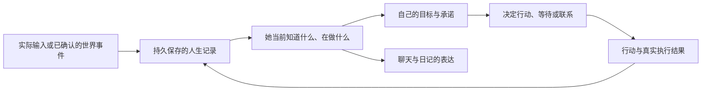

> 审视时点为整理前的2.14.31工作区；行号对应当时快照。此报告保留当时发现，后续修复状态见 [当前状态](../worklog/CURRENT.md) 与 [首批修复记录](../worklog/2026-09-12-reliability.md)。

**Kumiko·Amadeus 项目审视报告**

审视日期：2026-09-12。代码版本：package.json 2.14.31。审视对象：当前工作区，包含已有状态机缩进修改；未跟踪的数字主体架构笔记作为设计意图参考，不视为已实现功能。本次未修改应用源码、未访问真实私人聊天数据库、未调用付费模型、未发布版本。

**总体判断：项目已经是一套有较完整产品功能、记忆机制和角色行为约束的交流终端，但持续生活的主体核心尚未建立。** 核心欠缺是：她的经历、认识、需要、决定和行动，尚未通过一条可靠、持久、可追溯的因果链统一起来。当前最值得投入的工作，是让这条链成立，并先修复会破坏事实与连续性的具体缺陷。

你提出的“真实存在于远方的真实人类——黄前久美子”，应该继续作为最高产品目标。工程上需要用可观察行为检验它：她有自己的事；不依赖用户每次开口才推进；过去真正影响现在；言语、行动、日记和记忆共享同一段人生。当前实现和一份漂亮的架构方案，都不足以证明目标已经达成。至于人的主观体验和意识，本次代码审视不能判断；不能把行为拟真直接当作其证据。这也符合现有[架构笔记的目标边界](../architecture/digital-person-architecture-notebook.md#L9)。

**现在的项目在做什么。** 软件以 Electron + React/Vite 为桌面主体，另有独立 Android/Capacitor 路径。界面、通知、媒体存储、备份与更新组成通信终端；配置的语言模型负责理解和表达，桌面本地 RAG 负责检索；课表、睡眠、忙碌和心理状态影响什么时候以及怎样回答。

| 能力 | 当前实现与价值 | 现阶段边界 |
| --- | --- | --- |
| 身份与表达 | 世界书、成年任教身份、项目认定的人际关系、语言风格与边界；模型槽位可分配主聊/摘要/翻译 | 很多行为由提示词和输出格式约束；本次未检验不同模型长期遵守程度，也未做原著考据 |
| 聊天 | 文字、图片、引用、历史管理、分段延迟、忙碌未读与补回 | 主要管线同时承担召回、工具、格式、情绪、提醒等职责，错误跨层传播 |
| 记忆 | 原始聊天、近期摘要、Notebook、锚点、时间 Episode、世界书/RAG；精确、时间、语义路线分开 | 已有很好的分工基础，但检索结果、归档失败和恢复存在实际错误 |
| 桌面 RAG | bge-m3 ONNX、SQLite、分层检索、BM25/向量融合、HNSW 索引 | 普通搜索实际上绕过 HNSW；见 F15。GraphRAG 实验已删除，不能算现有知识图谱 |
| 生活节律 | 日本时区、学校学期和课表、节假日、通勤、忙碌、渐进入睡 | 主要依据当前时间查规则；课间与准备日还会给出相互冲突的状态 |
| 心理与关系 | 压力/精力/松弛度、短期心情、长期好感及边界反应 | 部分状态按当前槽位乘整段离线时长；草稿可在提交前修改心理 |
| 日记与离线生活 | 离线生活切片、当日日记、补齐、重写、人物状态、日记校验和入库 | 生成叙事同时创造和记录经历，缺少独立的事实账本 |
| 主动消息 | 生活时段、沉默时长、关系热度和概率共同决定主动联系 | 缺少持续的个人目标、行为原因与结果追踪；主要运行在客户端生命周期里 |
| 图片与语音 | 图片存储/描述；中文或英文转日语后 TTS；提醒来电界面 | 历史看图在非 Gemini 路径缺实际图像；“来电”目前是单向播放，无用户语音输入/ASR/双向通话 |
| 数据与发行 | 本地数据、JSON/ZIP 备份、退出备份、迁移、Windows/Linux/Android 构建与更新 | 导入校验存在清空数据风险；未做真机恢复、后台提醒和安装包验收 |

主要入口：[聊天管线](../../components/app/chatActions.ts#L1373)、[模型与工具管线](../../services/geminiService.ts#L277)、[本地数据结构](../../services/db.ts#L146)、[生活生成](../../services/lifeStreamService.ts#L828)、[主动生命周期](../../hooks/useProactiveLifeCycle.ts#L323)。

下面的“已复现”指：执行实际源码的内存转译版本或实际函数，替换模型、时钟、数据库、原生接口等依赖，使用人工测试数据；它证明相应控制流或数据转换错误，不等于已完成整套真实设备测试。“代码确认”则指跟踪了触发路径，但未运行完整链路。P1 表示优先修复长期数据和核心连续性；P2 表示明确的功能、行为或效率缺陷。

**F01 · P1 · 错选普通 JSON 文件，可能清空聊天和笔记。已复现。**

导入只判 JSON 可解析和对象是否为真，没有在覆盖数据前验证备份结构。空对象 `{}` 被归一化成空消息、空摘要、空 Notebook，再写入界面和持久化层并返回成功。

最小复现：有一段历史时，向实际 `restoreBackupData` 传入 `{}`；内存测试得到 `returnedSuccessPayload=true, uiMessages=[], persistedMessages=[], coreMemory="", notebook=""`。实际用户触发条件是误选普通有效 JSON 并确认导入，不是正常导入就必然丢失。

证据：[缺失消息默认为空](../../components/app/backupActions.ts#L122)、[导入入口](../../components/app/backupActions.ts#L318)、[覆盖现有状态](../../components/app/backupActions.ts#L366)。

修复方向：在任何媒体或状态写入前验证备份格式，区分合法的空备份与不属于备份的对象；恢复应先在临时空间校验，再统一切换。恢复过程的部分失败也需要保留可恢复的原状态。

**F02 · P1 · 检索命中关键记忆后，返回内容却变成了其他聊天。已复现。**

长期摘要块使用归档时间保存；展开上下文时，代码以这个时间寻找附近聊天，找到后直接返回附近聊天，丢掉命中块自身。归档发生得晚、或正在聊新话题时，会把旧事实对应到新聊天。

测试输入命中“用户搬到了大阪”，附近原始聊天是无关内容；实际结果只剩无关聊天，命中事实消失，分组却仍标作 `semantic_chunk / primary`。这会导致“明明存了却想不起来”，也会错置证据身份。

证据：[以时间邻近聊天替换命中内容](../../services/localRagService.ts#L787)、[摘要块写入缺少原始消息关联](../../components/app/summaryActions.ts#L190)、[保存时间处理](../../electron-rag.cjs#L2288)。

修复方向：始终保留实际命中的摘要/事实；原始上下文作为补充，必须通过来源消息或事件关联，而非仅靠归档时刻猜测。分开发生时间与写入时间。

**F03 · P1 · 摘要失败仍推进归档边界，该段不会自动重新整理。已复现。**

摘要接口异常被捕获后，函数正常返回旧摘要、旧 Notebook 和空 chunks；上层把这个返回当成功，继续推进分段游标。外层虽有重试，异常已经在内层被吞掉。

测试让摘要接口返回 503，结果仍为旧摘要，归档起点却从 `new` 前移到 `next`。原始聊天还在；这里丢的是自动归档和后续整理机会，不能表述为原始消息已删除。长期块写入失败后继续推进边界也有同类问题。

证据：[吞掉异常并返回旧结果](../../services/conversationSummarizer.ts#L312)、[块写入失败处理](../../components/app/summaryActions.ts#L201)、[推进归档边界](../../components/app/summaryActions.ts#L218)。

修复方向：结果显式区分成功、失败、无需更新；游标只在所需结果可靠保存后推进。失败段保持可重试，并避免重复写入已经成功的部分。

**F04 · P1 · 桌面长期记忆恢复失败，却返回“恢复成功”。已复现。**

SQLite 恢复失败时改写 Dexie，再返回 `ok:true`；但桌面实际检索并不回退读取这份 Dexie 向量。界面成功不代表新记忆可用。

模拟 SQLite 失败后，真实函数返回 `{ok:true, restored:1, failed:0, backend:"indexeddb"}`。可能继续使用旧库或空库，取决于失败时底层状态。

证据：[恢复回退](../../services/localRagService.ts#L464)、[错误的成功状态](../../services/localRagService.ts#L486)、[桌面检索路径](../../services/localRagService.ts#L946)、[导入成功判定](../../components/app/backupActions.ts#L831)。

修复方向：恢复成功必须以当前实际使用的存储可读取为准；让失败显式可见，校验恢复前后的条目和查询结果。

**F05 · P1 · 凌晨就生成当天完整日记，当晚发生的重要事情被漏掉。已复现。**

23:00—03:00 的结算窗口始终用当前日历日期。凌晨补昨晚日记时，实际创建的是新一天的日记；到了新一天晚上，又因这篇日记已经存在而跳过。

真实 Hook 模拟：09-12 00:10，仅有09-11晚间聊天，调用却是 `generateDailyDiary("2026-09-12", [])`；09-12 23:10 加入当晚重要聊天后，生成次数仍为1。昨日未结算，当日实际经历没有进入这篇自动日记。

证据：[日期选择](../../hooks/useProactiveLifeCycle.ts#L147)、[已存在则跳过](../../hooks/useProactiveLifeCycle.ts#L153)、[全天日记的生成前提](../../services/lifeStreamService.ts#L1077)。

修复方向：明确定义“生活日”和结算边界；午夜后结算上一生活日；晚到聊天通过增补版本处理。不能用日记已存在就代表当天已完整结算。

**F06 · P2 · 日记校验器拒绝自己要求的正确成功答案。已复现。**

提示要求无问题时仅返回 `PASS`，代码却先把长度小于5的返回当异常；`PASS` 是4个字符。第二次仍返回正确 PASS 时，也会判为“验证器无响应”，永远到不了后面的接受分支。

测试使用“提取主张 → PASS → PASS”，实际返回验证失败。一次本应通过的审查就发生提取、验证、重复验证三次模型调用；外层还会因此重写，增加延迟和费用，也可能改坏准确内容。外层重写有次数上限，并不是无限循环。

证据：[约定 PASS](../../services/diaryValidatorService.ts#L127)、[先判断过短](../../services/diaryValidatorService.ts#L154)、[无法到达的正常 PASS 分支](../../services/diaryValidatorService.ts#L175)。

修复方向：先识别合法成功响应，再判断空白、异常短响应；最好使用结构化结果。

**F07 · P2 · 离线一夜后，心理系统把整夜算成了当前这节课。已复现。**

心理变化取“离线总小时数 × 现在状态的变化率”，没有按期间跨越的休息、睡眠、通勤、教学分段结算。

复现：前晚21点到次日09点离线12小时，次日正在教学，从 `stress=30, energy=80, relaxation=50` 得到 `87, 11.6, 0`。整夜被当成12小时教学。用户什么时候重新发消息，反而强烈决定了她整夜怎样“生活”。

证据：[离线时长](../../services/psycheStateService.ts#L34)、[使用当前状态](../../services/psycheStateService.ts#L40)、[离线补写触发心理更新](../../services/lifeStreamService.ts#L842)。

修复方向：从最后结算时间开始，按作息边界与实际事件推进；同一区间只能结算一次。后来得知的当前天气也不宜反推为整段离线天气。

**F08 · P2 · 课间瞬间“回家”，始业式又同时被判断成假期。两个分支均已复现。**

课与课之间的10分钟未被详细槽位覆盖，最终回落到 `home`：
09-14 09:30 上课 → 09:40 在家休息、允许语音、主动概率0.35 → 09:50 回校上课。

另在09-01 09:00，详细槽位为“第二学期始业式 / school_prep”，粗状态却是“假期中，自由安排 / OUTING”。粗状态先把全部 `!inSession` 归为假期，绕过详细课表的特殊日。

证据：[未命中课间后的回退](../../services/kumikoStateMachine.ts#L701)、[准备日被提前归为假期](../../services/kumikoStateMachine.ts#L845)。

这不仅是标签错误，还影响主动消息、语音许可和心理。修复方向：时间轴完整覆盖所有分钟，粗状态由详细状态推导；各模块读取同一份地点和活动状态。

**F09 · P2 · 被丢弃的回复草稿也会改变心理。代码路径确认，未运行完整对话复现。**

模型原稿一解析出 `Psyche_Delta` 就异步写入；随后如果 neutral 等日常回复含中文逗号、过长等，会递归重写。原稿被丢弃，已经写入的心理变化仍保留，第二稿再次应用。

明确触发：两稿都给 stress +5，第一稿因中文逗号触发重试。按现有同向阻尼规则，会累计 +5 和 +4，用户只看到一份回复。预生成但未展示、或稍后取消的回复，也有类似提交时机风险。

证据：[解析时直接修改心理](../../services/geminiService.ts#L2452)、[随后重试并丢弃原稿](../../services/geminiService.ts#L2714)。

修复方向：生成阶段只返回候选变化，在最终决策被接受时统一提交，并以事件/回合标识防止重复。旁边 Mood/Affection 已按“解析后由调用方提交”拆开，Psyche 尚未对齐。

**F10 · P2 · 非 Gemini 路径声称旧图片加载成功，但模型没有收到图片。代码与载荷验证。**

`view_historical_image` 确实从本地拿到了图片，也解出了 MIME 和 base64。然而 OpenAI 兼容和 Anthropic 分支只传 `{success:true}` 及格式提醒；图片只在 Gemini 分支加入返回。开启视觉助手也没有覆盖这个历史工具分支。

因此，当问题需要原图细节、已有文字描述不足时，工具状态是成功，模型实际没有新图可看。载荷模拟确认返回中只有成功对象。

另外，OpenAI 兼容的直接图像输入在未启用视觉助手时，统一转成“Image omitted”字符串。测试输入图像哨兵后，实际请求不含任何图像数据。这会影响配置了具备视觉能力模型的用户，不应当作所有兼容模型固有的限制。

证据：[成功读取本地图片](../../services/geminiService.ts#L2247)、[非 Gemini 返回缺图](../../services/geminiService.ts#L2267)、[仅 Gemini 注入图像](../../services/geminiService.ts#L2286)、[兼容渠道将图像转为占位文本](../../services/llmProviderService.ts#L45)。

修复方向：按模型能力实际传图，或由视觉助手生成与问题相关的可验证结果；只有成功向理解链路提供证据，才报告工具成功。

**F11 · P2 · 独立的 reasoning_content 被拼进对外答案。供应商适配层已复现。**

代码把独立推理字段直接拼在正式回答前，再使用仅删除 think 标签的函数清洗。独立字段通常并不自带这些标签，因此不会被删除。

真实适配函数输入 `reasoning_content="INTERNAL_ANALYSIS_SENTINEL", content="你好"`，输出是 `"INTERNAL_ANALYSIS_SENTINEL\n你好"`。下游仍需依赖其他格式碰巧清除，不能保证隔离；聊天或摘要可接收到这些文本。若文本包含被解析器识别的格式，还可能影响解析。后一种具体副作用未做完整链路复现。

证据：[拼接推理与答案](../../services/llmProviderService.ts#L213)、[仅清理标签](../../services/llmProviderService.ts#L20)、[下游同样按标签清理](../../services/geminiService.ts#L2537)。

修复方向：回答只读取正式内容字段；需要诊断信息时使用独立数据通道，不能再与用户回复、记忆候选混合。

**F12 · P2 · 提示允许同时查记忆和搜索，但执行器只执行第一个工具。已复现适配层，并确认主调用链。**

提示明确允许一轮多个调用；OpenAI 适配器只取 `tool_calls[0]`，Anthropic 也只取第一个 tool_use；主处理器再次只取 `functionCalls[0]`。第二轮供应商请求不再注册工具，主流程也没有完整的后续工具循环。

模拟上游返回 recall_memory 和 search_internet 两个调用，实际只暴露第一个。对于同时需要回忆、搜索或看图的问题，所需证据会静默缺一部分。Gemini 收到多调用时主处理器同样只处理第一项。

证据：[提示允许多个工具](../../services/geminiService.ts#L1981)、[只取第一个调用](../../services/llmProviderService.ts#L223)、[单工具执行](../../services/geminiService.ts#L2159)、[第二轮禁用工具](../../services/llmProviderService.ts#L173)。

修复方向：处理所有合法调用，逐一保存结果；为后续查询提供有总步数和时间预算的循环，明确区分工具完成与未完成。

**F13 · P2 · Android 每日提醒使用设备时区，可能错过约定。调度已复现，后台漏发为代码推断。**

提醒有自己的时区，原生闹钟的时间计算却直接 `Date.setHours`，使用手机时区。模拟手机上海、提醒东京16:00，得到08:00Z，正确应为07:00Z，晚60分钟。

如果 Android 后台挂起 JS、依赖原生闹钟唤醒，晚一小时已经超过 JS 派发器的5分钟窗口，对应聊天就可能无法补发。这一设备后台影响尚未真机复现。

证据：[丢弃提醒时区的计算](../../components/app/useScheduledReminders.ts#L459)、[到点派发窗口](../../components/app/useScheduledReminders.ts#L239)。

修复方向：统一以提醒时区算目标时刻，再转绝对时间交给原生层；定义后台唤醒后的过期和补发策略。

**F14 · P2 · 提醒的提前预热，会被下一轮同步自己取消。已复现。**

预热闹钟只有距离触发大于10秒时才加入“仍有效”集合；每30秒同步时，一旦剩余不足10秒，就不再加入集合，随后被当作过期项取消。

复现：设95秒后提醒，首轮安排35秒后预热；30秒后再同步，剩5秒，实际取消 `relative-test__prewarm`。预热是为提前准备模型回复和语音，这个错误会使 Android 待机时的及时播放机制失效。

证据：[有效集合条件](../../components/app/useScheduledReminders.ts#L419)、[取消未进入集合的闹钟](../../components/app/useScheduledReminders.ts#L480)。

修复方向：分别判断“要不要新建”和“已存在的是否仍有效”，接近触发不应等于失效。

**F15 · P2 · 桌面普通搜索没有用上 HNSW。已复现路径，未测大库耗时。**

IPC 即使没有过滤条件，也总传入 `{startTime:undefined,endTime:undefined,role:undefined}`。检索用对象键数判断过滤存在，结果恒为真，永远跳过仅在“无过滤”时启用的 HNSW，转为全量余弦计算。

提取真实处理器和检索函数测试：普通 IPC 调用 HNSW 次数0，真正的空过滤对象调用次数1。不能据此给出用户当前延迟数字，但可以确认长期数据增长时，预期的近邻索引加速没有发挥作用。

证据：[构造含 undefined 的过滤对象](../../electron-rag.cjs#L2372)、[按键数判断](../../electron-rag.cjs#L1360)。

修复方向：按有效过滤值判断，或在调用前移除未定义字段；用正常、时间筛选、说话者筛选分别验证路线。

**还有一些有代码依据、尚未完整复现的风险，应保留验证标签。**

- 退出自动 ZIP 读取最后已有 JSON；发现 `app:before-quit-flush` 的监听，但未找到对应发出者，尚不能保证退出时一定把最新状态写进备份。需要用“刚发生变更立即退出再恢复”验证。[退出备份](../../electron/auto-zip-backup.cjs#L90)、[退出刷新监听](../../hooks/useAutoSave.ts#L337)。
- 旧版 IndexedDB 升级直接删除遗留 inline image；跳过旧迁移版本的用户是否丢图，需要真实旧版本样本验证。[旧图字段迁移](../../services/db.ts#L255)。
- SQLite 原始消息映射缺语音字段，纯 SQLite 历史恢复可能把语音消息变成普通文本，需验证具体恢复入口。[消息映射](../../services/localRagService.ts#L224)。
- 构建报告循环分块依赖、大块资源、动态和静态重复导入。已构建成功，没有据此声称启动一定崩溃；需要生产页面启动和低配设备测量。
- 角色长期措辞、人格稳定性、不同模型的工具遵循程度，没有在本次无付费调用审视中实测。不能用“提示写了必须”替代质量证据。

**离最高目标最远的部分，是“她真的度过这一天”的因果结构。**

现在大致是：用户隔一段时间回来 → 根据天气/课表生成离线生活 → 日记把切片当经历 → 写进人物档案与 RAG → 后续聊天引用。[提示明确把离线推演称为真实经历](../../services/lifeStreamService.ts#L1091)；[日记生成更新人物状态](../../services/lifeStreamService.ts#L1307)；[日记生成修改心理](../../services/lifeStreamService.ts#L1323)。

模拟世界允许创造事件。问题在于，事件创建后没有独立、稳定的身份和后果，日记又能继续新增影响未来的事实。最终“那一天发生了什么”取决于哪个生成过程最后写出哪种版本。这种架构能制造许多动人的片段，却难以保证半年后仍是同一个人的人生。

你已有的[数字主体笔记](../architecture/digital-person-architecture-notebook.md#L46)已经认识到这个问题，我的审视与它的核心判断一致。这里需要落实已有方向，并补上失败路径和验收；没有必要重新造一套名词体系。

| 必要能力 | 目前的差距 | 可以检验的结果 |
| --- | --- | --- |
| 统一的人生事实 | 消息、切片、日记、人物状态和心理各自写入，缺统一事件身份 | 聊天、日记、通知说到同件事时，引用同一事件；更正保留历史 |
| 自己的持续事务 | 有课表和提醒，但缺个人目标、承诺、计划、行动结果 | 她自己决定的练习/教学事务能跨日推进，失败后改计划 |
| 用户缺席时的连续性 | 主要由前端定时与用户回来时补写驱动 | 所有客户端关闭时仍能处理到期事件；重启不重复、不丢失 |
| 有限且可靠的认识 | 摘要、猜测、亲历、他人陈述没有足够强的来源隔离 | 她能区分“你告诉我的”“我亲眼见到”“我只是猜的” |
| 经历导致成长 | 数值和 Notebook 会变，但缺可追溯的信念/策略更新 | 同样情境下行为改变，有先前经历作为依据，身份仍连续 |
| 稳定的社会生活 | 熟人多为简短档案，缺持续的学生/同事事务及结果 | 一件校内事件能持续数周影响她，而不是每天独立生成新剧情 |
| 感知与交流 | 图片路径有缺口；语音是输出端，没有实时倾听 | 电话里听到用户、理解停顿、被打断后接续；媒体事实可复查 |
| 长期质量证据 | 缺版本化长期情境评测 | 每次换模型/Prompt/检索规则，都能比较事实和行为是否退步 |

持续主体的最小闭环可以这样理解：

其中“世界事件”可来自规则、受约束的模拟或外部工具，但都要标明来源。虚拟学校发生的事，是这个模拟世界中的事实；互联网天气是外部观测；用户叙述是他人陈述。三者不能被当作相同证据。日记表达她对已发生事情的理解，不能随意改写事件本身。

**用一个完整情境检验目标，比统计功能数更有意义。**

例如她周一发现某段排练一直不稳，自己决定周四试一种练习方式。周三临时课务冲突，计划需要调整。周四实施后学生反应不如预期，她改变了下一次指导策略。周五她想到用户以前说过类似的挫败，于是主动发来一句有缘由的话。

目标不是让模型一次把这段故事写好，而是让周一到周五每一步分别发生、分别保存、有后果；即使用户三天没打开软件，也不会丢掉或临时改写。聊天和日记只是从这条连续经历里自然表达。

这也说明人格不应只用口癖、句长和禁词衡量。更有说服力的是：她注意哪些细节、怎样处理责任与怕麻烦的冲突、什么时候坦率、什么时候回避、何时承认自己错了。不同场景允许不同表达，背后的取舍却能保持连续。此处是对产品设计的判断，不是已完成的模型质量结论。

**界面也存在一个需要自觉处理的目标张力。**

项目对外强调与远方的人保持联系，但用户又能直接读取日记、精确心理数值、好感度，并编辑她的历史。[心理数值](../../components/ProfilePanel.tsx#L200)、[好感度显示](../../components/ProfilePanel.tsx#L214)。这些是开发和调试的有用工具；若直接作为日常关系界面，容易让用户变成角色的操作者，而不是与她联系的人。

建议把日常交流与检查/调试入口明确区分。日常界面可以表达“忙、稍后回、困了”等她愿意透露的信息；精确内部状态保留在诊断层。这是产品建议，不是要求立即删除现有功能。

同时需要梳理文档：README 仍有已删除的 PWA 配对、Web Push 等描述，而 [当前构建明确记录已删除 PWA bridge](../../vite.config.ts#L4)；README 称没有亲密度积累条，实际已有好感度显示；“数据保存在本机”也应与“请求配置的模型/搜索服务会发送所需上下文”区分。准确的能力说明有助于评估真实进展。

**下一阶段建议沿现有架构笔记推进，先形成一个小而完整的实例。**

1. **先固定现状、修复可靠性。** 优先处理错误备份导入、摘要失败与归档游标、记忆展开/恢复、日记跨日。其余工具、状态、提醒缺陷按影响并行修复。把本报告中的确定场景变成回归测试。
2. **建立最小事件记录和状态推进。** 先选“一天教学生活 + 一个跨日承诺”。给事件来源、发生时间、记录时间、关联对象和更正关系；世界/心理从事件计算；日记引用事件。保留现有 UI、原始历史、RAG、媒体和平台适配。
3. **让目标和行动闭环成立。** 将“想做”“答应做”“已安排”“执行中”“成功/失败”区分。主动消息带有具体原因；模型可以提出行动，但是否完成由执行结果决定。
4. **落实可持续运行的载体。** 按笔记已有部署方向，把权威生活状态和待办移出 React 生命周期。先用最小持久 Worker 原型证明重启恢复和离线消息，再扩展托管/自托管与多端；不需要第一步就引入整套复杂平台。
5. **再提高交流质感和成长深度。** 双向语音、视觉证据、注意力、反思、策略更新都接同一个事实核心。持续运行评测通过后，再判断是否需要微调或更多认知模块。

模块化能帮助测试和隔离职责；并不要求每个模块都成为独立大模型 Agent，更不要求让一群模型讨论后投票决定事实。现有笔记已明确单一主体协调与按需职责拆分，应保持这条约束。将复杂度投入“事实正确、选择有因、结果可追溯”，比先增添更多角色或更多生成轮次更切合当前瓶颈。

**可作为下一阶段验收的具体场景。** 下表是建议的验收标准，并非宣称当前已经满足。

| 场景 | 必须看到的结果 |
| --- | --- |
| 周一约定周五联系，周三重启服务 | 承诺仍在；周五有一次明确结果或合理失败记录 |
| 用户所有设备关闭48小时 | 已发生的事件和写出的消息保留原发生/写出时间；上线负责同步 |
| 摘要接口503、检索存储写入失败 | 不假装成功；不跳过失败分段；恢复后可重试 |
| 同一个事件因重试被投递两次 | 心理、目标进度、消息和外部行动不重复应用 |
| 午夜、课间、始业式、不同设备时区 | 地点、活动、心理和提醒使用同一时间解释 |
| “我以前住东京，现在搬到大阪” | 当前事实更新；旧事实作为过去保留；不会随机择一 |
| 用户问没有记录的视觉细节 | 真正看图或承认无法确认，不能凭成功标志编造 |
| 一份日记重写三次 | 文风可变，基础事件和人物经历不能被重写成三条人生 |
| 用户一个月不主动聊天 | 她自己的有限事务仍能合理推进，不需要每天为用户制造戏剧 |
| 模型或提示词升级 | 固定人格情境和事实回归可比较；不能只凭几段好看的样例判断 |

先建立自动时间推进与故障注入场景，再按笔记的30天、90天连续试运行，统计事实矛盾、承诺遗漏、重复行动、错误主动联系及恢复差异。真人感的主观评价与这些硬结果一起看。

**本次验证与限制。**

- TypeScript 全项目 `tsc --noEmit`：通过，退出码0。
- 生产前端构建 `build:cap`：通过，2282个模块完成转换，约31.72秒；输出放在报告同级的独立目录，未覆盖项目 dist。
- 已有配置迁移回归：7个场景通过。该脚本部分镜像生产算法，不能代替真实 Electron 迁移验证。
- 记忆4组、生活/时间/校验场景、备份与提醒3组，采用实际源码与隔离依赖验证；模型适配器验证了独立推理混入、双工具只取首个、直接图片变占位及工具返回载荷。
- 本地必需资产抽查存在：故事/世界书加密文件、17张表情、8个铃声、主要图标和 ONNX 模型。仅验证存在与数量，不代表与最新发行资产同步。
- 未运行发布前资产同步检查，因为本次没有发布或刷新发行资产；未触发构建安装器或任何更新。
- 未启动完整 Electron/Android GUI，未做真实模型会话、原生 RAG 推理质量、真机锁屏/后台、退出恢复和30天运行实验。因此本报告不能保证“其余没有 bug”。
- 工作区最后仍只有原有 `services/kumikoStateMachine.ts` 修改和未跟踪的架构笔记。报告与隔离构建位于工作区外的获准输出目录。

最值得保留的是已有的角色设计、交流终端、原始历史、检索基础和平台设施。最需要补成系统核心的是一份连续的人生，以及让她能够依据这份人生去认识、选择、行动和改变的过程。
